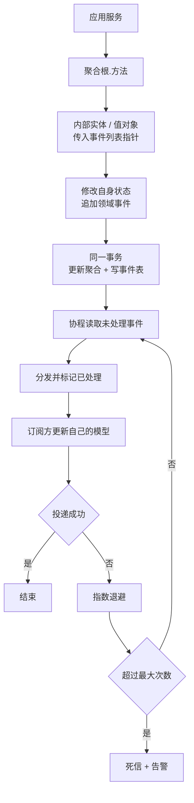

# 聚合边界如何划分

只要满足以下两点中的任意一点，就可以考虑归为一个聚合：

1. 这些属性、实例或值对象经常在一起更改、一起读取
2. 它们之间存在不变式，需要保持一致性

好处是聚合内的属性可以保证强一致性，代价是随着业务增长，聚合会越来越大，加载变得困难。

这时候就要问一个问题：这些数据真的不能有中间状态吗，还是说可以用最终一致性？

如果结论是可以最终一致（大部分业务确实如此），那就改成持有其余模型的业务标识，借助领域事件达成最终一致性。

## 一次请求的流转

一个聚合中的属性通过聚合根修改，聚合根持有一个事件列表。对于聚合内的模型，调用其方法时把聚合根的事件列表指针作为参数传入，在改完自身状态后，向事件列表追加事件。

最后显式地从聚合根的事件列表里取出事件，在同一个事务内持久化到事件表。

之后有一个协程定期读取未处理的事件表，把事件分发出去（分发后标记为已处理），订阅事件的一方再去修改自己的模型，实现最终一致性。投递失败就指数退避，超过最大努力次数后标记为死信，并向技术人员告警。

## 什么时候可以拆，什么时候必须合并

对于可以容忍损失的场景，可以像上图一样把聚合拆开，也就是尽可能小的聚合——这也是 DDD 所推荐的，好处是读的时候加载得少，并发性能也更高。

但是对于会有资产损失的场景，还是需要放在一个聚合里面。即使拆开，也不应该考虑基于事件的最终一致性，而应该考虑 TCC。

## 打破原则的四种情况

DDD 的理论里，一次请求只能修改一个聚合。以下四种情况可以考虑打破：

| 情况         | 说明                                                                                   |
| ------------ | -------------------------------------------------------------------------------------- |
| 方便用户界面 | 需要一次性大批量插入多个聚合。若"分多次请求各改一个"和"一次请求改多个"没有区别，可以合 |
| 缺乏技术机制 | 技术栈老旧、重构困难，引入不了消息队列这类可以实现最终一致性的组件                     |
| 全局事务     | 通过尽可能小的聚合来缩短事务时间                                                       |
| 查询性能     | 聚合适当直接持有其他聚合的引用，可以免去多次关联查询，比如 N+1 问题                    |

第三、四条和第一条的方向其实相反：一条是嫌拆得不够，另一条是必须合并。判断依据始终是"一致性要求和性能，哪个更贵"。

## 真的需要实体吗

大部分时候，是不是可以先尝试建模为值对象？

值对象的优点是不需要担心多处引用导致数据不同步（因为修改总是返回一个新的值对象），序列化友好，也可以作为其中一个字段和实体存在同一张表里。

比如用户的道具背包，可以建模为值对象，直接以 JSON 的形式存在某一列中。代价是无法部分更改，以及检索内容困难。

如果尝试把它单独分出来一张表，并持有用户业务标识的引用，即使自己没有唯一的业务标识，从某种意义上说也算是一个"实体"了——这一点是 IDDD 所批评的。

但我不这么认为。如果一个实例的生命周期从属于上层，且从语义上可以被完全替换，那么分表只是值对象持久化的一种合理手段，并不改变它在领域模型里的身份。

## 一段 IDDD 的案例

> 基于以上所有分析，团队并不打算将 Task 从 BacklogItem 中分离出来。他们还不清楚这样的分离是否会带来风险……他们决定暂时保留先前的做法。这是有很多好处的：首先风险并不大，因为目前的实现方案已经工作得很好；另外，如果之后决定把 Task 从 BacklogItem 中分离出来，它仍然可以工作……

IDDD 里他们做了评估，已经设计好了最终一致性的实现方案，但由于现在的业务量并不大，决定保留现状，暂时不对聚合进行拆分。将来有必要时仍然会拆，但那时候的变更肯定会受制于很多已经依赖"不拆分"做出的业务逻辑。

这也正是最难受的地方：强一致性和最终一致性之间，极难有一个统一的接口可供替换实现。
