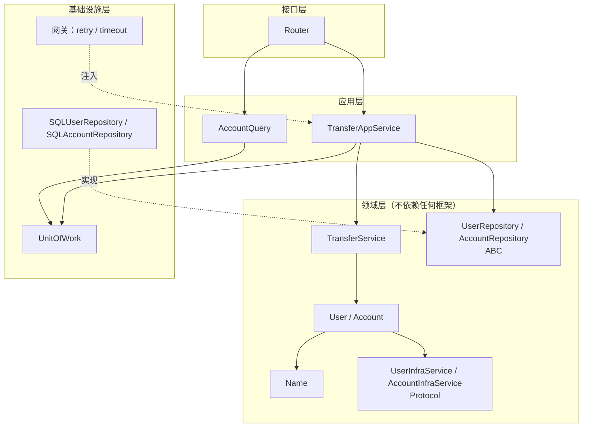
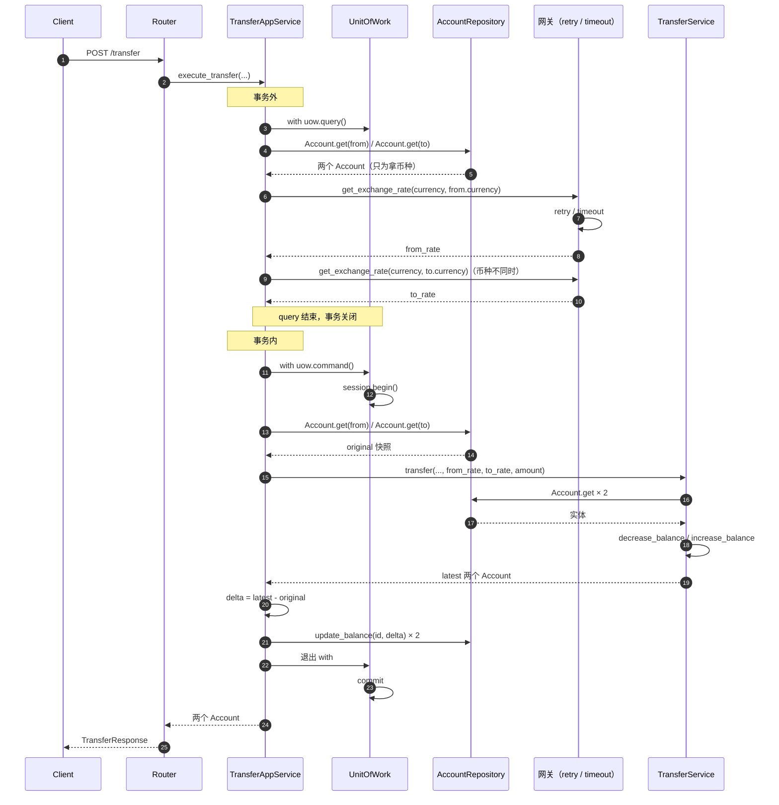
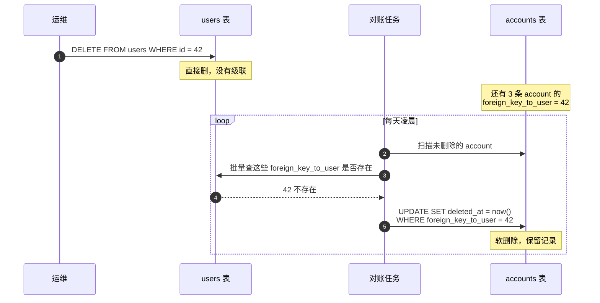

# 分层：从"聚合互相引用"到读写分离

这篇记录一次重构。第一版写出来的时候觉得挺顺，后来发现有一处违反聚合原则，拆掉之后连带整个值对象都消失了，最后变成读写分离。

两个版本都放在 examples 里：

- [ddd_v1.py](../examples/ddd_v1.py) 是改动前的样子，`User` 聚合里挂着 `AccountCenter`
- [ddd_v2.py](../examples/ddd_v2.py) 是改动后的样子，读写分离、汇率传参、外部 API 全部走网关
- [router_example.py](../examples/router_example.py) 是 v2 的接口层

## 核心架构决策总结

1. **聚合边界**：绝不允许聚合相互引用。跨聚合的查询一律走 CQRS 读端（DTO/JOIN），写端通过领域服务协调。
2. **依赖注入**：实体绝不持有 Repository/Infra。所有依赖通过方法参数传入，用完即弃。
3. **快慢分离**：事务（command）内只允许纯内存计算 + 数据库查询（快依赖）。所有网络请求（如查汇率）必须在事务外完成，将结果作为参数传入实体。
4. **异常控制权**：值对象只返回状态（Bool），实体负责自身校验并抛异常，领域服务负责跨聚合校验并抛异常。
5. **并发控制**：
   - 状态替换（如订单状态）用**版本号（乐观锁）**。
   - 纯增减（如余额）用**条件更新（`balance >= 0`）**防超卖。
   - 如果增减逻辑依赖其他状态（如币种），必须**双管齐下（版本号 + 条件更新）**，因为“版本号保护的是你基于什么做的判断”。
6. **防死锁**：多行更新必须按**被锁主键**升序执行，而非业务 ID。

## 依赖方向



箭头只有两个方向：上层指向下层，基础设施指向领域层定义的接口。

## 第一版

一开始 `User` 里挂了一个值对象 `AccountCenter`，装的是这个用户名下的账户 ID 集合。

```python
class User(DomainEntity):
    def __init__(self, uid: int, name: Name, account_center: AccountCenter, version: int):
        super().__init__(uid, version)
        self._name = name
        self.account_center = account_center

    def bind_accounts(self, new_account_ids: set[int], infra: UserInfraService):
        new_account_center = AccountCenter(new_account_ids)
        if not new_account_center.accounts_exists(infra):
            raise UserException("at least one account is not exists")
        if not new_account_center.all_account_bind_with_the_user(self.uid, infra):
            raise UserException("at least one account is not subordinate to the user")
        self.account_center = new_account_center
```

`AccountCenter` 是个 frozen dataclass，除了装 ID，还能算总资产：

```python
@dataclass(slots=True, frozen=True)
class AccountCenter:
    account_ids: set[int]

    def include_account(self, account_id: int) -> bool:
        return account_id in self.account_ids

    def get_total_balance(self, infra: UserInfraService, currency: Currency) -> Decimal:
        return Decimal(
            sum(
                account.balance * infra.get_exchange_rate(account.currency, currency)
                for account in infra.get_total_account(self.account_ids)
            )
        )
```

看 `bind_accounts` 就能感觉到不对劲。一次"绑定账户"的操作，背后查了两次外部数据：`accounts_exists` 查账户存不存在，`all_account_bind_with_the_user` 又把同一批账户捞出来查归属。

`get_total_balance` 更直接，把每个账户的余额全拉出来了。

这些东西都不是 `User` 自己的状态，是别人的数据。只是写着顺手，就都塞进来了。

## 问题在哪

问题出在 `get_total_balance`。它让 `User` 聚合拿到了 `Account` 聚合的数据。

一开始我以为这没什么，反正只读。后来想到一个场景：

```
A 聚合和 B 聚合的版本号都是 1。

线程 1：通过 A 读到了 B 的数据，基于它做了判断，修改了 A。
        A 的版本号变成 2。

线程 2：在这期间修改了 B。
        B 的版本号也变成 2。

线程 1：保存 A。
        因为没人在这中间修改过 A，乐观锁通过，保存成功。
```

保存成功了，但线程 1 的判断是建立在"已经被改过的 B"上面的。版本号只保护了自己这一行，保护不了"读到的别人"。

这个场景说明，聚合之间只要发生读取依赖，一致性就没法靠版本号兜住。要么把两个聚合合成一个，要么让领域服务来编排，读的时候保证两个都是最新的。

所以规则是：禁止一个聚合以任何手段拿到另一个聚合。

## 拆掉之后

`User` 里跟账户相关的方法全部删掉，包括 `bind_accounts`、`add_account`、`remove_account`。`UserInfraService` 里的 `get_account` 和 `get_total_account` 也删了。

此时 `AccountCenter` 就悬空了。它本来只服务于两个目的：判断归属、算总余额。

判断归属这件事，`Account` 自己就能做（它有 `foreign_key_to_user`），领域服务直接比对就行，不需要 `User` 掺和。

算总余额是另一回事。它需要遍历用户所有的账户，本质上是展示需求，不是业务规则。转账、冻结这些操作都是针对某一个具体账户的，从来不会"针对总余额"。

所以这个需求从一开始就不该放在领域模型里。

## 读端

把"算总余额"挪到一个独立的读模型里：

```python
class AccountQuery:
    """读端，可以直接写SQL，怎么方便怎么来"""

    def __init__(self, uow: UnitOfWork):
        self.uow = uow

    def get_total_balance(
        self,
        infra: AccountInfraService,
        get_exchange_rate: ExternalRateAPI,
        user_id: int,
        currency: Currency,
    ) -> Decimal:
        with self.uow.query():
            accounts = infra.get_total_account(user_id)
            rates = {
                c: get_exchange_rate(c, currency)
                for c in {a.currency for a in accounts}
            }
            return Decimal(sum(a.balance * rates[a.currency] for a in accounts))
```

汇率查询按币种去重。20 个账户如果只有 3 种币种，就只查 3 次，而不是 20 次。

汇率这个参数也是网关传进来的，和写端一样。读端没有事务，调慢接口不会拖长什么，但既然网关已经封装好了重试和超时，复用它更省事。

读端不受聚合规则约束。它可以一次 join 五张表，可以写复杂的 SQL，怎么快怎么来，因为它不修改任何东西，也不承担一致性责任。

代价是读端和写端会各有各的模型。同一个"账户"，写端是聚合根，读端可能是一个扁平的 DTO。两边字段对不齐的时候需要人肉维护，这是读写分离固有的成本。

## UoW 的两个通道

写端要事务，读端不要。所以 `UnitOfWork` 提供两个入口：

```python
class UnitOfWork:
    def __init__(self, session_factory):
        self.session_factory = session_factory
        self.session: Session | None = None

    # 有事务，给写模型用
    @contextmanager
    def command(self):
        try:
            self.session = self.session_factory()
            self.session.begin()
            yield self
            self.session.commit()
        except Exception:
            self.session.rollback()
            raise
        finally:
            self.session.close()

    # 无事务，给读模型用
    @contextmanager
    def query(self):
        try:
            self.session = self.session_factory()
            yield self
        finally:
            self.session.close()
```

`command` 里 `raise` 那一行不能省。上下文管理器的默认行为是把异常继续往上抛，但如果你自己写了 try/except 又没 raise，异常就被吞了，事务虽然回滚了，调用方却以为成功了。

`query` 不调 `begin`。只读事务在多数数据库里仍然要占连接和快照，能省就省。

## 汇率不要在实体里查

读端按币种去重就够了，写端还有一个更要紧的问题。

同币种的账户之间转账，两次操作会查同一个汇率对。假设 100 USD 转给一个 CNY 账户，from 和 to 都是 CNY：

```
decrease_balance  → 查 USD -> CNY = 7.20，扣 720
increase_balance  → 再查一次，假如跳到 7.21，加 721
```

扣了 720，加了 721，账上多出一块钱。

一开始的做法是给事务套一层汇率缓存，让两次都拿同一个值。但这么做只解决了一半：汇率查询本身是 HTTP 请求，放在事务里，对方超时三秒，事务就开三秒。

所以后来改成把汇率当参数传进去，实体不再自己查。

```python
class Account(DomainEntity):
    def decrease_balance(self, rate: Decimal, amount: Decimal):
        new_balance = self._balance - amount * rate
        if new_balance < 0:
            raise AccountException("the balance can't less than 0")
        self._balance = new_balance

    def increase_balance(self, rate: Decimal, amount: Decimal):
        self._balance += amount * rate
```

领域服务也接收 rate：

```python
class TransferService:
    def transfer(
        self, from_user, to_user, from_account_id, to_account_id,
        from_rate, to_rate, amount,
    ) -> tuple[Account, Account]:
        from_account = Account.get(from_account_id, self.account_infra)
        if from_account.foreign_key_to_user != from_user.uid:
            raise AccountException(...)

        to_account = Account.get(to_account_id, self.account_infra)
        if to_account.foreign_key_to_user != to_user.uid:
            raise AccountException(...)

        from_account.decrease_balance(from_rate, amount)
        to_account.increase_balance(to_rate, amount)
        return from_account, to_account
```

应用服务分两段跑：

```python
def execute_transfer_v2(self, from_uid, to_uid, from_account_id, to_account_id, amount, currency):
    # 事务外：拿币种、查汇率
    with self.uow.query():
        from_account = Account.get(from_account_id, self.account_infra)
        to_account = Account.get(to_account_id, self.account_infra)

    transfer_service = TransferService(self.account_infra)

    # self.get_exchange_rate 是网关注入进来的函数，不是资源库
    from_rate = self.get_exchange_rate(currency, from_account.currency)
    if from_account.currency == to_account.currency:
        to_rate = from_rate
    else:
        to_rate = self.get_exchange_rate(currency, to_account.currency)

    # 事务内：读最新值、算、写
    with self.uow.command():
        from_user = User.get(from_uid, self.infra)
        to_user = User.get(to_uid, self.infra)

        original_from = Account.get(from_account_id, self.account_infra)
        original_to = Account.get(to_account_id, self.account_infra)

        latest_from, latest_to = transfer_service.transfer(
            from_user, to_user, from_account_id, to_account_id,
            from_rate, to_rate, amount,
        )

        from_delta = latest_from.balance - original_from.balance
        to_delta = latest_to.balance - original_to.balance

        # 币种用事务外那次读的（from_account / to_account），不是 latest_*
        if from_account_id < to_account_id:
            rows1 = self.account_repo.update_balance(from_account_id, from_delta, from_account.currency)
            rows2 = self.account_repo.update_balance(to_account_id, to_delta, to_account.currency)
        else:
            rows2 = self.account_repo.update_balance(to_account_id, to_delta, to_account.currency)
            rows1 = self.account_repo.update_balance(from_account_id, from_delta, from_account.currency)

        if rows1 == 0 or rows2 == 0:
            raise TransferServiceErr("concurrency conflict, please retry")

    return latest_from, latest_to
```

`update_balance` 是这样实现的：

```python
def update_balance(self, account_id: int, delta: Decimal, expected_currency: Currency) -> bool:
    cur = self.uow.session.execute(
        "UPDATE accounts "
        "SET balance = balance + :delta, version = version + 1 "
        "WHERE id = :id "
        "  AND currency = :expected_currency "
        "  AND balance + :delta >= 0",
        {"delta": delta, "currency": expected_currency, "id": account_id},
    )
    return cur.rowcount == 1
```

传进去的 `expected_currency` 是"我算 delta 时用的那个币种"。数据库里的币种如果还是它，就更新；如果不是，影响行数为 0，返回 False，抛出去重试。

`version = version + 1` 留着是维护版本号本身，别的地方可能要用。这次的条件判断用的是币种，不是版本号。

版本号在 SQL 里加，不在内存里加。如果先在内存 `increase_version()` 再写回，UPDATE 一失败，实体上的版本就比数据库多 1，后面拿这个实体做别的事都会出错。

汇率这一步其实不需要缓存层。币种相同的时候直接复用 `from_rate`，不同的时候才查第二次，这样最多查两次，而且两次查的是不同的币种对，本来就不会互相干扰。

之前那层 `TransactionScopedRateInfra` 已经删掉了。它解决的问题（同一个汇率被查两次、结果不一致）现在用"币种相同就复用"直接绕开了。

`transfer_service` 是局部创建的，不在 `__init__` 里注入了。因为汇率已经变成参数传进去，`TransferService` 不再需要那个"带缓存的 infra"，直接用 `self.account_infra` 就够了。

`original` 和 `latest` 都是在同一个 command 事务里读的，中间没有网络调用，只有内存计算。RR 隔离级别下两次读看到的是同一个快照，所以 `latest - original` 就是这次操作真正改了多少。

delta 不需要在应用服务里手算。业务怎么变、变多少，还是实体说了算，应用服务只负责做差和落库。

实体现在不依赖 `infra` 了，`decrease_balance` 变成了纯计算。测试的时候给两个 `Decimal` 就行，不用造假的汇率服务。

## 币种在事务外读，中途变了怎么办

汇率是事务外查的，币种也是在事务外读的。这中间账户可能被改，比如迁移到了另一个币种。

delta 是按币种算出来的。币种一变，这个 delta 就失效了，可余额本身完全没毛病。

第一反应是用版本号兜：币种改了，version 跟着变，带上 version 条件，影响 0 行就抛出去重试。

能挡住，但粒度太粗。账户上任何一个字段变了，version 都会变。一次和币种无关的并发修改，也会让这次转账白白失败。

更直接的办法是把币种写进 WHERE：

```python
def update_balance(self, account_id: int, delta: Decimal, expected_currency: Currency) -> bool:
    cur = self.uow.session.execute(
        "UPDATE accounts "
        "SET balance = balance + :delta, version = version + 1 "
        "WHERE id = :id "
        "  AND currency = :expected_currency "
        "  AND balance + :delta >= 0",
        {"delta": delta, "currency": expected_currency, "id": account_id},
    )
    return cur.rowcount == 1
```

只保护真正依赖的那个字段。币种变了才失败，别的不影响。

这里有个认识上的转弯。

一开始以为版本号只保护"状态的修改"，比如订单从 `CREATED` 到 `PAID`，没有 delta 可算，只能整体替换，所以要版本号。余额是增减型的，用条件更新就够了。

后来发现这次是"修改本身依赖了某个状态"。delta 是按币种算的，币种变了 delta 就失效。于是得出一个结论：版本号保护的不是"我改了什么"，是"我基于什么做的判断"。

这个判断是对的，但还能再进一步。既然已经知道"基于什么"了，为什么不把它直接写进 WHERE？

```sql
WHERE id = :id AND currency = :expected_currency
```

比版本号精确，也没有"这个版本号是哪一次读的"这种问题。

| 场景 | 用什么 |
|---|---|
| 只改增减量，不读别的状态 | 条件更新 |
| 增减量依赖某个状态属性 | 条件更新，把这个属性写进 WHERE |
| 改状态本身，依赖的字段多到写不下 | 版本号 |

第三行才是版本号该出场的地方。判断标准不是"要不要版本号"，是"这次判断依赖了哪些字段，能不能一条一条写进 WHERE"。能写就写，写不下再退回版本号。

版本号还有个坑：必须用事务外那次读到的 `from_account.version`，不能用事务里重新读出来的 `latest_from.version`。`latest_from` 是 `transfer` 在事务内重新取的最新值，如果币种在这期间被改过，它的 version 也往前走了，条件永远成立，写进去的却是按旧币种算的 delta。

用币种当条件就没这个问题。币种是算 delta 时用的那个值，直接拿来比，不存在"读的是哪一份"的歧义。

## 网关：慢依赖的唯一出口

`AccountInfraService` 里原本有两个方法：

```python
class AccountInfraService(Protocol):
    def get_account(self, uid: int) -> Account | None: ...
    def get_exchange_rate(self, f: Currency, t: Currency) -> Decimal: ...
```

一个是数据库查询，零点几毫秒。一个是 HTTP，可能三秒。

同样是"接口"，但耗时差三个数量级。放在一个协议里，调用方看不出区别，也没法据此设计事务边界。

所以后来把慢依赖整个搬出去，单独成一层：网关。

### 网关做什么

网关只干一件事：把外部 API 包装成"可以被调用的函数"，并且在这一层处理掉所有和"外部"有关的麻烦事。

```python
class GateWayException(Exception):
    def __init__(self, api_type: str, func_name: str, message: str):
        self.api_type = api_type
        self.func_name = func_name
        self.message = message
        super().__init__(f"{api_type} - {func_name}: {message}")


class TimeOutError(GateWayException):
    ...
```

重试、超时、熔断、降级、异常转换，全部在网关层完成，应用服务拿到的已经是一个"看起来像普通函数"的东西。

```python
def retry(n: int):
    def decorator(func):
        @wraps(func)
        def wrapper(*args, **kwargs):
            for _ in range(n - 1):
                try:
                    return func(*args, **kwargs)
                except GateWayException:
                    pass
            return func(*args, **kwargs)
        return wrapper
    return decorator
```

组装的时候层层套上去：

```python
get_exchange_rate = timeout(5)(retry(3)(get_exchange_rate_api))
```

`safe` 这个词在这里很贴切。应用服务只管"调它，拿结果"，不知道底下重试了几次、超时了几秒。

### 网关和资源库的区别

| | 资源库 | 网关 |
|---|---|---|
| 依赖 | 数据库 | 外部服务 |
| 耗时 | 毫秒 | 秒级 |
| 谁可以调 | 领域层 | 只有应用服务 |
| 失败怎么处理 | 抛异常，事务回滚 | 重试、超时、降级 |
| 返回什么 | 聚合或值对象 | 原始数据（货币汇率、布尔值） |

资源库返回的是领域对象，网关返回的是原始值。资源库的失败意味着"这次业务失败了"，网关的失败往往意味着"换个时间再试"。

### 领域层要跟着改

`get_exchange_rate` 从 `AccountInfraService` 里删掉之后，`Name` 的 `is_safe` 也保不住了，因为它背后也是 HTTP。

```python
# 之前：值对象自己调 API
def is_safe(self, infra: UserInfraService) -> bool:
    return infra.is_safe(str(self))

# 之后：删掉，合法性由应用服务算好传进来
```

`User.change_name` 的签名跟着变：

```python
def change_name(self, new_first_name: str, new_last_name: str, safe: bool):
    if not safe:
        raise UserException("the name contains unsafe characters")

    new_name = Name(new_first_name, new_last_name)
    if not new_name.length_is_valid():
        raise UserException(f"User name is too long, max is {USER_NAME_MAX_LAN}")
    self._name = new_name
```

应用服务先调网关查敏感词，把 `bool` 传进来。

这是"慢依赖不能进模型"的直接后果：模型不再自己查，而是接收已经算好的结论。检查本身没有消失，只是搬到了事务外面。

### 一个必须守住的边界

领域模型的方法总是在事务里跑。应用服务 `with uow.command()` 一进来，实体和领域服务里的每一次 `get_account`、每一次 `get_user` 都在事务内。

数据库查询零点几毫秒，放进去没事；HTTP 三秒，事务就三秒。

所以领域层能调的资源库必须是快的。慢的走网关，网关只给应用服务用。这条边界一旦破了，事务时间就不可控了。

## Repository 与 Mapper

仓储的语义是"聚合的存取"，调用方拿到的应该是 `User`，不是一行数据。Mapper 的语义是"表和对象之间的转换"，它认识列名，但不认识聚合。

Mapper 藏在仓储实现里：

```python
class SQLUserRepository(UserRepository):
    def __init__(self, uow: UnitOfWork):
        self.uow = uow

    def get_user(self, uid: int) -> User | None:
        row = self.uow.session.execute(
            "SELECT id, first_name, last_name, version FROM users WHERE id = :id",
            {"id": uid},
        ).fetchone()
        if row is None:
            return None
        return UserMapper.to_domain(row)

    def save_user(self, user: User) -> None:
        self.uow.session.execute(
            "UPDATE users SET first_name = :f, last_name = :l, version = :v "
            "WHERE id = :id AND version = :old",
            UserMapper.to_row(user),
        )
```

领域层看不到 `UserMapper`。换数据库或者换 ORM，领域层不用动。

## Protocol 还是 ABC

仓储用 ABC，因为它是一份血缘契约：

```python
class UserRepository(ABC):
    @abstractmethod
    def get_user(self, uid: int) -> User | None: ...

    @abstractmethod
    def save_user(self, user: User) -> None: ...
```

具体实现必须继承，少一个方法或者签名不对，实例化时就会报错。这种强制性适合底层基础设施。

领域层需要的只是"能力"，用 Protocol：

```python
class AccountInfraService(Protocol):
    def get_exchange_rate(self, f: Currency, t: Currency) -> Decimal: ...
    def get_account(self, uid: int) -> Account | None: ...
    def get_total_account(self, user_id: int) -> list[Account]: ...
```

领域层不关心传进来的是哪个类，这些方法在就行。这也是领域层能做到不 import 任何具体实现的原因。

## 异常控制权

按"语义属于谁"来决定谁抛，一共三级。

值对象只返回状态。实体判断自身状态合不合法，不合法就抛。领域服务判断跨聚合之后的结果，不合法也抛。

```python
def change_name(self, first_name: str, last_name: str, safe: bool):
    if not safe:
        raise UserException("the name contains unsafe characters")

    new_name = Name(first_name, last_name)
    if not new_name.length_is_valid():
        raise UserException(f"User name is too long, max is {USER_NAME_MAX_LAN}")
    self._name = new_name
```

`length_is_valid()` 返回 bool，由实体决定要不要抛。`safe` 也是 bool，只不过它是应用服务从网关拿到的，不是实体自己算的。

为什么值对象不自己抛？同一个 `Name`，在注册场景长度不对是错误，在展示场景可能只是截断成简称。值对象只知道自己合不合法，不知道调用方要拿它干什么。

为什么"越权"要由领域服务抛？资金归属这件事，只有把 `Account` 和 `User` 放在一起看才成立。`Account` 自己只有一个 `foreign_key_to_user` 字段，它不知道谁在操作。

三层的分工：

| 谁       | 抛什么             | 例子                  |
| -------- | ------------------ | --------------------- |
| 值对象   | 不抛，只返回状态   | `length_is_valid()` 返回 bool |
| 实体     | 自身状态不合法     | 名字超长、余额为负    |
| 领域服务 | 跨聚合组合后不合法 | 账户和用户对不上      |

应用服务不抛业务异常，它只负责顺序和事务。

## 依赖不存 self

实体要查汇率，但不能把服务存成属性。

```python
# 不要这样
class User:
    def __init__(self, repo, rate_api):
        self.repo = repo
        self.rate_api = rate_api
```

实体如果要被缓存或者写进事件表，`self.repo` 会跟着一起序列化，直接失败。Repository 一般持有 Session，挂在实体上会让连接一直不释放。

所以依赖都走方法参数，用完就丢。

## 领域层能调基础设施吗

严格按书上的说法不能。实际写的时候，实体要查数据库（比如 `Account.get`），总得有个出口。

这里的做法是让领域层依赖 Protocol。接口本身不限制你做什么，真正划线的是一条约定：这些接口必须只读、幂等、没有副作用。

汇率已经不在这个通道上了。它是慢依赖，走网关，由应用服务算好传进来。前面那节讲过。

所以这条通道上剩下的只有资源库，也就是数据库查询。数据库查询是只读的，也不会改变任何状态。

"没有副作用"这一条最要紧，也最容易被破坏。

假设某天有人在 `Account.decrease_balance` 里顺手加了一句：

```python
def decrease_balance(self, rate: Decimal, amount: Decimal, infra: AccountInfraService):
    new_balance = self._balance - (amount * rate)
    if new_balance < 0:
        raise AccountException("the balance can't less than 0")
    self._balance = new_balance
    infra.publish("account.debited", {"uid": self.uid, "amount": amount})
```

看起来只是发一条通知，实际上有四处会出问题。

最直接的是事务还没提交。这一行在 `uow.command()` 里执行，此时事务还没 commit。如果后面 `save_account` 撞上乐观锁冲突，整个事务回滚，钱没扣，但消息已经发出去了。下游收到"账户已扣款"，实际账上没动。

测试也会变难。以前测 `decrease_balance` 只要给个 `Decimal` 和假汇率，现在还要造一个假的 MQ 客户端，再断言它收到了什么。测试从"验证状态"变成"验证交互"，越来越脆。

再往后是维护。如果改名、绑定账户、扣款都在各自实体里发消息，那么"所有用户变更都要通知风控"这种需求，就得挨个找。这就是霰弹式修改。业务规则散在实体里，没有一个地方能看全。

所以写副作用必须放在应用服务。应用服务知道事务边界在哪，也天然是"一次业务操作"的完整描述。

| 类型 | 放哪 | 例子 |
|---|---|---|
| 只读查询 | 领域层，通过 Protocol | 查汇率、查敏感词、查账户是否存在 |
| 写副作用 | 应用服务 | 发 MQ、发短信、扣库存落库、commit |

"只读"这一条也不是绝对的。查汇率要发 HTTP，本身就是外部调用。但只要它是幂等的、不改变任何状态，就还在可接受的范围里。真正不能碰的是"改变了别的东西"。

## 防腐层什么时候才需要

代码里原来有个 `InfraAdapter`，把碎的 Repository 和 API 拼成领域层要的接口。后来删了。

原因很简单：在同一个限界上下文里，这些 `Protocol` 本来就是自己定义的，想怎么改就怎么改。领域层依赖协议，基础设施实现它，中间再夹一层 Adapter 属于多余。

防腐层（ACL）要解决的是另一件事：两个上下文之间的模型冲突。

比如你的领域里有个 `User`，对方系统的接口返回 `userDto`，字段名不一样，状态值不一样，空值的含义也不一样。这时候才需要一层转换，把对方的模型翻译成你的。

同一个上下文内，接口就是契约。跨上下文才需要翻译。

所以示例里没有 ACL。哪天要对接第三方支付、物流这类外部系统，那才需要补上。

## 并发控制：版本号只是其中一种

上面那套是"UoW 管事务 + 版本号做乐观锁"。它是其中一种做法，高并发下不一定合适。

现在的写法，保存时会带上版本号做条件：

```python
UPDATE accounts SET balance = :balance, version = :version
WHERE id = :id AND version = :old_version
```

两个人同时转账，都读到 `version = 5`。一个提交成功，version 变成 6。另一个更新影响 0 行，只能重试：重新读、重新算、重新写。并发越高撞车越多，重试还会把流量放大。

余额这种字段，变化永远是加或者减，没必要整体替换。可以改成对比快照算增量，再用条件更新。

模型自己实现 clone，只复制需要比较的字段：

```python
class Account(DomainEntity):
    def clone(self) -> Account:
        return Account(
            uid=self._uid,
            balance=self._balance,
            currency=self._currency,
            foreign_key_to_user=self._foreign_key_to_user,
            version=self._version,
        )
```

修改前拍一张快照，改完对比：

```python
snapshot = account.clone()
account.decrease_balance(amount, currency, infra)
delta = account.balance - snapshot.balance
```

然后按增量更新，条件只用来防负余额：

```python
def apply_delta(self, account: Account, delta: Decimal) -> bool:
    cur = self.uow.session.execute(
        "UPDATE accounts SET balance = balance + :delta "
        "WHERE id = :id AND balance + :delta >= 0",
        {"delta": delta, "id": account.uid},
    )
    return cur.rowcount == 1
```

两个人同时扣 100，第一句把 1000 变成 900，第二句把 900 变成 800，两笔都成功，没有重试。

它的代价是只对"可以写成增量"的字段有效。像订单状态 `CREATED -> PAID` 这种没有 delta 可算，还是得用版本号。另外快照只应该复制参与比较的字段，全量复制在大对象上会很慢。

## 两行一起更新会死锁

转账要同时改两个账户。两个请求方向相反的时候，加锁顺序不一致就会死锁。

```
请求 A：账户 1 -> 账户 2
请求 B：账户 2 -> 账户 1

A 锁住 1，等着拿 2
B 锁住 2，等着拿 1
→ 互相等对方释放
```

InnoDB 有死锁检测，跑一会儿会发现环，挑一个事务回滚，报 `Deadlock found when trying to get lock`。回滚的那个请求就算失败了，得重试。

解法是让所有请求按同一个顺序加锁。账户主键是唯一的，按主键排序就行：

```python
if from_account_id < to_account_id:
    first_id, first_delta, first_currency = from_account_id, from_delta, from_account.currency
    second_id, second_delta, second_currency = to_account_id, to_delta, to_account.currency
else:
    first_id, first_delta, first_currency = to_account_id, to_delta, to_account.currency
    second_id, second_delta, second_currency = from_account_id, from_delta, from_account.currency

rows1 = self.account_repo.update_balance(first_id, first_delta, first_currency)
rows2 = self.account_repo.update_balance(second_id, second_delta, second_currency)

if rows1 == 0 or rows2 == 0:
    raise TransferServiceErr("concurrency conflict, please retry")
```

这里有个容易写错的地方：排序键必须是**被锁的那一行的主键**。

有人会按 `from_uid < to_uid` 排，因为转账的发起人和接收人更直观。但锁的是 `accounts` 表，一个用户可能有好几个账户，uid 的大小和 account_id 的大小没有对应关系。按 uid 排出来的顺序，实际去锁的时候还是乱的。

如果项目里做了业务 ID 和持久化 ID 的分离（业务 ID 给用户看，持久化 ID 做 `bigint` 主键），这里还有一层要当心：排序用的必须是持久化主键。

业务 ID 一般是字符串，比如 `ACC-20261116-0001`。字符串按字典序比较，和数据库里 B+ 树按主键大小的顺序不是一回事。拿它排序，加锁顺序仍然是乱的。所以代码里 `if from_account_id < to_account_id` 这两个变量，必须是持久化主键。

死锁不只出现在转账。任何"一个事务里更新多行"的场景都可能，比如批量扣库存、批量转移、批量改状态。规律一样：先定一个全局顺序，所有代码都按它来。

死锁也没法完全消除。就算是同一份代码，和别的模块交叉加锁时仍然可能撞上。所以最后还是要靠重试兜底，上面那个 `rows == 0` 的检查就是入口。

## 路由层

```python
def get_transfer_service() -> TransferAppService:
    """每个请求一套新对象，UoW 持有 Session，不能跨请求共享。"""
    uow = UnitOfWork(SessionLocal)

    # 网关：超时和重试在这一层套上去，应用服务拿到的是普通函数
    get_exchange_rate = timeout(5)(retry(3)(get_exchange_rate_api))

    return TransferAppService(
        uow=uow,
        user_repo=SQLUserRepository(uow),
        account_repo=SQLAccountRepository(uow),
        user_infra=...,          # 实现 UserInfraService 的对象
        account_infra=...,       # 实现 AccountInfraService 的对象
        get_exchange_rate=get_exchange_rate,
    )


@router.post("", response_model=TransferResponse)
def transfer(req: TransferRequest, service: TransferAppService = Depends(get_transfer_service)):
    from_account, to_account = service.execute_transfer(
        req.from_uid, req.to_uid, req.from_account_id, req.to_account_id, req.amount, req.currency
    )
    return TransferResponse(
        from_account_id=from_account.uid,
        from_balance=from_account.balance,
        to_account_id=to_account.uid,
        to_balance=to_account.balance,
    )


@app.exception_handler(DomainException)
async def handle_domain_exception(request, exc: DomainException):
    return JSONResponse(status_code=400, content={"detail": str(exc)})
```

`get_transfer_service` 每次返回新对象。UoW 里有 Session，做成单例的话多个请求会串数据。

那两个省略号是实现了对应 `Protocol` 的对象。`Protocol` 是结构化类型，方法对得上就行，不需要显式继承，所以组装的时候传什么都行，只要能力齐全。具体传哪个类，取决于仓储和网关怎么拼，和分层本身无关。

路由里没有 try/except。业务异常统一交给 `exception_handler`，转成 400。每个路由只写正常路径。

## 完整调用链



事务外那段只做两件事：拿币种、查汇率。查汇率走的是网关，重试和超时都在那一层，应用服务拿到的就是一个普通函数。

事务内不碰网络，只有数据库读写和内存计算。

中间任何一步抛 `DomainException`，`command` 的 `except` 会回滚，异常继续上抛，Router 不接，最后被 `exception_handler` 转成 400。

## 孤儿账户怎么处理

`Account.foreign_key_to_user` 指向一个 `User`。创建账户时从仓储里取出这个用户，用它的 uid 赋值，这一步能保证当时是有效的。

但用户可能在之后被删掉。这时 `accounts` 表里就留下一批指向不存在用户的账户，叫孤儿账户。

这类问题没法靠"使用前再检查一次"解决。检查完到真正写入之间，用户仍然可能被删，中间这几十毫秒的窗口没有任何机制能锁住（TOCTOU）。唯一可靠的办法是对账。



对账任务扫的是"尚未删除的账户"，用 `foreign_key_to_user` 批量去 `users` 查一圈，查不到的标记 `deleted_at`。

用软删除而不是物理删，是为了留记录。账户上如果还有余额，删掉就查不到钱去哪了。审计和对账都需要这张表还在。

当然了，实际不能只靠凌晨的扫描（因为这会让用户等太久，而且状态不一致的时间窗口越久，脏读的风险就越高），在删除账户的同时需要用发件箱模式存入一个用户已删除事件，定期发送未处理的事件。然后软删除账户处理器监听这个事件(如果只是内存队列的话，理论上不需要凌晨扫描，但是作为最终兜底还是有必要的)