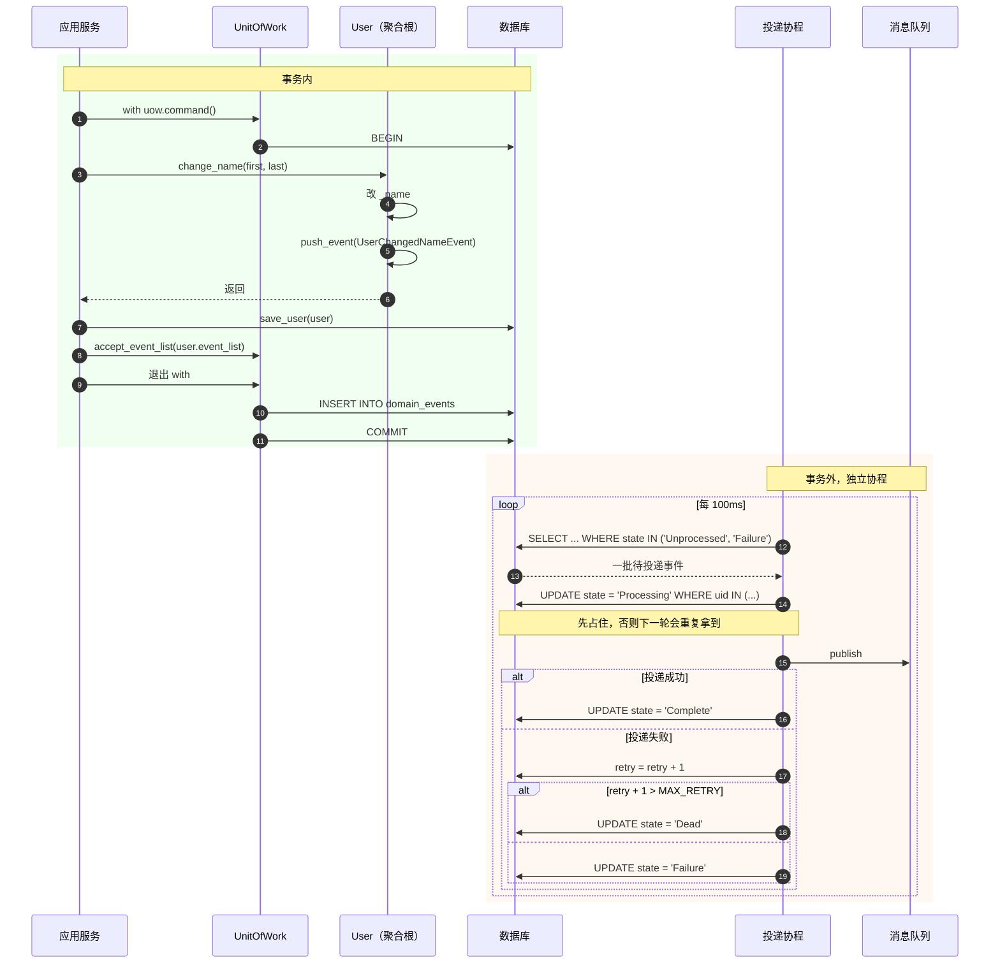

# 为什么不用全自动的 UoW

《实现领域驱动设计》虽然打着"比《领域驱动设计》更注重落地"的旗号，但它对 UoW 的描述其实不如 PEAA 详细。

PEAA 里，UoW 主张主导数据更新：自动 diff、追踪脏对象，让开发人员完全无感。但在过于复杂的模型里，diff 撑不住，PEAA 作者自己在书里也退到了"全删全插"这种粗暴做法。

## PEAA 里 UoW 的两个职责

一是事件。如果选择在应用服务层显式追加事件，UoW 负责把事件存起来，退出时发出去。

二是脏数据。改动之前把实例注册给 UoW，UoW 存一份快照；退出时拿现在的值和快照对比，拼出只更新变化部分的 SQL。早期没有成熟 ORM，这一层还要配查询对象做封装，非常复杂。

## diff 为什么在复杂模型里撑不住

关键在于，写业务的人没法预测 UoW 退出时会生成多少次调用，也没法控制它改的是哪些字段。

举一个具体的例子。实例上有个字段 A，快照里是 20，退出 UoW 时变成了 5。业务约束说 A 不能低于 10。如果 UoW 拼出的是条件更新 `WHERE a + delta >= 10`，那没问题，影响行数能反映出来。

但如果这次改的是 B 字段呢，或者 C 字段呢。每一个字段都有自己的约束，而 UoW 不知道"这次到底动了哪个"。它只能全部拼进去，或者干脆全部更新。

当然可以执行多条 SQL，或者把所有条件拼成一串。但那样的代码会非常难看，而且拼出来的 SQL 和业务规则之间隔了一层，出问题很难查。

## 手动注册事件太粗

另一个职责是事件。手动在应用服务层向 UoW 注册事件，是粗粒度的。

一次请求里，聚合、实体、值对象都可能产生事件。事件是在领域模型内部产生的，什么时候产生、产生几个，只有模型自己知道。应用服务在调用前后做一次注册，粒度对不上。

## 改成聚合根持有事件列表

所以事件列表应该放在聚合根上。

聚合内的实体和值对象在修改自身状态时，把聚合根的事件列表指针传进去，往里面追加事件。领域服务或应用服务在退出事务前，把聚合根的事件列表拷贝一份交给 UoW，UoW 在提交前写进事件表，配合发件箱模式完成投递。

这样粒度就对了：事件在产生的地方被记录，在事务的边界被收集。

```python
import json
from contextlib import contextmanager
from dataclasses import dataclass, field, asdict
from datetime import datetime
from enum import StrEnum
from itertools import count
from typing import Any, Callable

from sqlmodel import Session

_uid_counter = count(1)


class EventState(StrEnum):
    Unprocessed = "Unprocessed"
    Processing = "Processing"
    Complete = "Complete"
    Failure = "Failure"
    Dead = "Dead"


@dataclass(slots=True, frozen=True, kw_only=True)
class Event:
    aggregate_root_uid: int
    data: Any
    uid: int = field(default_factory=lambda: next(_uid_counter))
    name: str = ""
    created_at: datetime = field(default_factory=datetime.now)
    state: EventState = EventState.Unprocessed
    retry: int = 0

    def __post_init__(self):
        object.__setattr__(self, "name", type(self).__name__)


@dataclass(slots=True, frozen=True, kw_only=True)
class UserChangedNameEvent(Event):
    @dataclass(slots=True, frozen=True, kw_only=True)
    class Data:
        original_name: str
        latest_name: str

    data: "UserChangedNameEvent.Data"
```

`__post_init__` 里用 `object.__setattr__`，是因为 `frozen=True` 之后普通赋值会报错，只能绕过去。

事件名直接用类名，省得每个子类再写一遍字符串。事件 UID 用自增计数器，保证同一个进程内不重复。

## UoW 多了一个事件列表

```python
class UnitOfWork:
    def __init__(self, session_factory: Callable[[], Session]):
        self._session_factory = session_factory
        self._session: Session | None = None
        self._event_list: list[Event] = []

    @property
    def session(self) -> Session | None:
        return self._session

    @property
    def event_list(self) -> list[Event]:
        return self._event_list[:]

    def accept_event_list(self, event_list: list[Event]) -> None:
        self._event_list = event_list[:]

    def _write_to_the_event_table(self) -> None:
        if not self._event_list or self._session is None:
            return
        self._session.execute(
            "INSERT INTO domain_events "
            "(uid, name, aggregate_root_uid, payload, created_at) "
            "VALUES (:uid, :name, :aggregate_root_uid, :payload, :created_at)",
            [
                {
                    "uid": e.uid,
                    "name": e.name,
                    "aggregate_root_uid": e.aggregate_root_uid,
                    "payload": json.dumps(asdict(e.data), ensure_ascii=False),
                    "created_at": e.created_at,
                }
                for e in self._event_list
            ],
        )

    @contextmanager
    def command(self):
        try:
            self._session = self._session_factory()
            self._session.begin()
            yield self
            self._write_to_the_event_table()
            self._session.commit()
        except Exception:
            self._session.rollback()
            raise
        finally:
            self._session.close()
            self._event_list = []
```

`_write_to_the_event_table` 放在 `commit` 之前，这样事件写入和业务数据在同一个事务里。业务失败就一起回滚，不会出现"事件发了但数据没存"。

`finally` 里清空事件列表，防止下次复用这个 UoW 实例时把旧事件带进去。

## 聚合根负责收集

```python
class DomainEntity(ABC):
    def __init__(self, uid: int, version: int):
        self._uid = uid
        self._version = version
        self._event_list: list[Event] = []

    @property
    def uid(self) -> int:
        return self._uid

    @property
    def event_list(self) -> list[Event]:
        return self._event_list[:]

    def push_event(self, event_type: type[Event], event_data: Any) -> None:
        self._event_list.append(
            event_type(aggregate_root_uid=self.uid, data=event_data)
        )
```

`event_list` 返回的是拷贝，外部拿到之后改动不会影响聚合根。这个细节很重要，否则应用服务在交给 UoW 的时候顺手改一下，聚合根的状态就被污染了。

## 改一次名字

```python
class User(DomainEntity):
    def change_name(self, first_name: str, last_name: str, safe: bool):
        if not safe:
            raise UserException("the name contains unsafe characters")

        new_name = Name(first_name, last_name)
        if not new_name.length_is_valid():
            raise UserException(f"User name is too long, max is {USER_NAME_MAX_LAN}")

        original_name = str(self.name)
        self._name = new_name

        self.push_event(
            UserChangedNameEvent,
            UserChangedNameEvent.Data(
                original_name=original_name,
                latest_name=str(self.name),
            ),
        )
```

`is_safe` 变成了一个 `bool` 参数。

因为敏感词检查背后是 HTTP，属于慢依赖，不能放进实体。实体拿到的是应用服务算好的结论，不是自己去查。

事件仍然在实体内部产生，因为只有实体知道"改名前叫什么、改名后叫什么"。

应用服务负责三件事：调网关、加载、交事件。

```python
def change_name(self, uid: int, first_name: str, last_name: str) -> None:
    # 事务外：走网关查敏感词
    safe = self.is_safe(f"{first_name} {last_name}")

    with self.uow.command():
        user = User.get(uid, self.infra)
        user.change_name(first_name, last_name, safe)
        self.user_repo.save_user(user)
        self.uow.accept_event_list(user.event_list)
```

敏感词查询放在 `with` 外面。这一步可能要几百毫秒，放进去会把事务拖长。

顺序是：先算出"合不合法"，再开事务做"读、改、存、交事件"。

## 事件从产生到落表



绿色那段是业务事务。事件和业务数据在同一个 `commit` 里落库，所以要么都成功，要么都失败。

橙色那段在事务外面，由独立协程轮询。

拿到事件之后，第一件事是把状态改成 `Processing`，然后才去投递。这一步不能省。如果只是"查出来、发出去、再改状态"，那么在发出去到改状态之间，下一轮轮询会把同一批事件再查一遍，造成重复投递。

五个状态，扫描的时候只认其中两个：

| 状态 | 含义 | 会被扫到吗 |
|---|---|---|
| `Unprocessed` | 刚写进表，还没投递 | ✅ |
| `Processing` | 已被某个协程占住 | ❌（卡住时靠超时回收） |
| `Failure` | 投递失败，等下一轮重试 | ✅ |
| `Complete` | 投递成功 | ❌ |
| `Dead` | 重试次数耗尽，不再自动重试 | ❌ |

`Processing` 这个状态本身也会卡住。如果投递协程改完状态就崩了，这条事件会一直停在 `Processing`，谁也处理不了。所以还需要一个兜底的回收逻辑：扫描 `state = 'Processing' AND updated_at < now() - 5min` 的记录，重置回 `Unprocessed`。

扫描的时候除了 `Unprocessed`，还要带上 `Failure`。失败的事件不会自己变回未处理，得靠下一轮重新捞出来。

但重试不能无限。每次失败 `retry` 加一，加完立刻判断有没有超过上限；超了就直接标 `Dead`，不再放回 `Failure`。这样 `Dead` 就成了一条"不再被自动扫描到"的终态，需要人工介入或者走死信队列。

`Dead` 和 `Failure` 的区别就在这儿：`Failure` 是"这次失败了，下次还试"，`Dead` 是"试够了，别试了"。

`retry` 不清零，防止"失败几次、成功一次、再失败"的抖动把计数刷掉。

这一段没有"丢消息"的风险，因为事件已经落盘了，最坏情况是延迟。

## 这套做法的代价

事件列表挂在聚合根上，聚合根因此多了一份状态。有人会担心序列化的时候把事件一起带出去。

这个担心其实不成立。落库走的是 PO，对外返回走的是 DTO，这两个都是可以是显式挑字段的，事件列表根本不会被带上。仓储的 `to_row` 只映射业务字段，接口层的响应模型也只声明要返回什么。

真正要留意的是另外一件事：`event_list` 必须返回拷贝。不然应用服务拿到列表之后顺手 append 一个，聚合根的状态就被改了，而且这种改动很难在测试里发现。

另外事件表会一直长。它需要定期清理，或者按时间分区，这部分 UoW 不管。

---

放弃的是"自动 diff 式"的 UoW，保留的是"事务边界 + 事件收集"这两件事。
