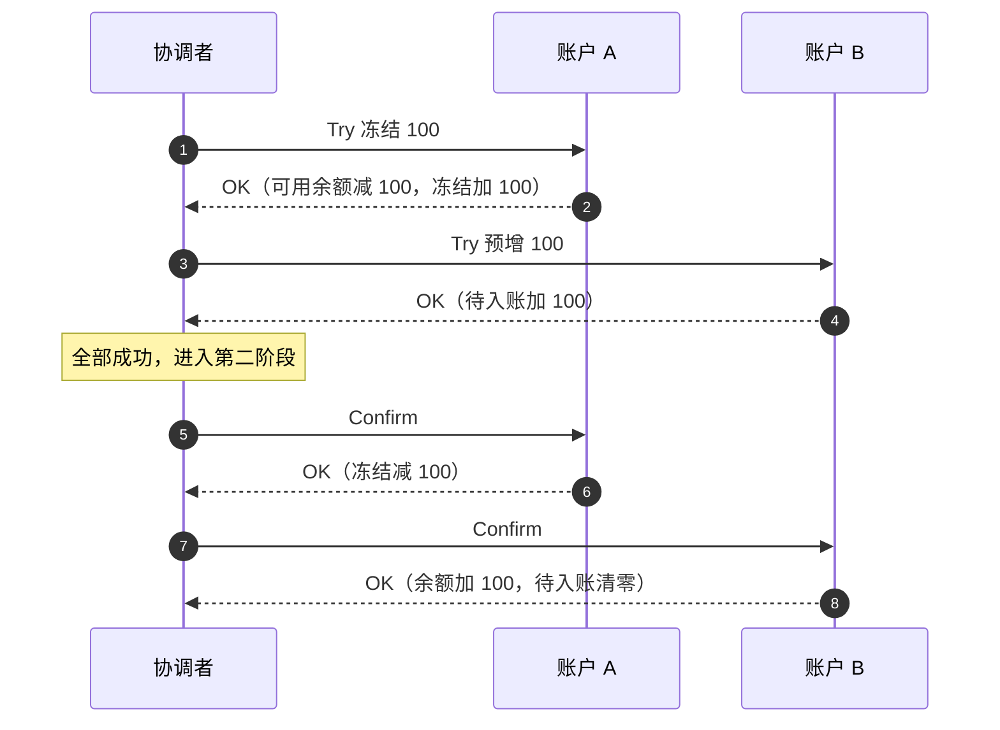
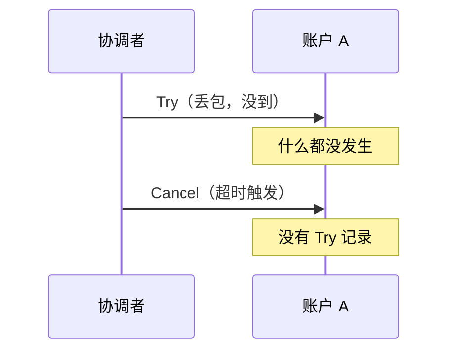
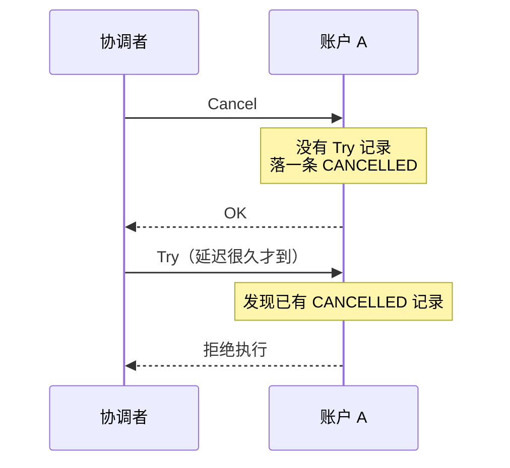

# TCC：三段式与三类异常

TCC 把一次分布式事务拆成三段：Try 预留资源，Confirm 真正使用，Cancel 释放预留。

正常情况很顺。麻烦全在异常上，尤其是网络超时和重试。

## 正常流程



Try 只做预留，不动真正的余额。所以中间状态对用户是可见的：可用余额少了，但还没转出去。

Confirm 和 Cancel 都必须幂等。协调者可能重试，也不能保证只调用一次。

## 资源：可用和冻结

TCC 的"预留"落到账上，是两个钱包：

- 可用余额 `available`
- 冻结余额 `frozen`

一笔 100 的冻结，账上大概是这样的：

| 阶段 | available | frozen |
|---|---|---|
| 初始 | 1000 | 0 |
| Try | 900 | 100 |
| Confirm | 900 | 0 |
| Cancel | 1000 | 0 |

Try 从 `available` 挪到 `frozen`，Confirm 把 `frozen` 清零，Cancel 原路退回去。

钱在任何时刻都在账上，只是"能不能用"不一样。

这就是 TCC 和 Saga 最根本的差别。Saga 没有 `frozen` 这个状态，它是直接扣掉，出问题再补一笔反向操作。所以 Saga 的补偿是"再转一次账"，TCC 的补偿是"解冻"。

两者可靠性差挺多。解冻只是同一个账户里挪数字，几乎不会失败；反向转账要走完整的支付链路，可能又失败一次。

## 三类异常

### 空回滚

Try 因为网络超时没到达，但全局事务已经超时，协调者开始发 Cancel。



如果直接按"回滚"处理，Cancel 会去释放一份从来没冻结过的资源，要么报错触发无限重试，要么改错数据。

正确做法是 Cancel 发现自己没有 Try 记录时，不报错，而是落一条"已回滚"的记录，然后返回成功。这样协调者能正常结束，不会一直重试。

### 悬挂

反过来。Cancel 已经执行完，Try 才姗姗来迟。



如果 Try 这时正常执行，资源就被冻结了，但整个事务已经结束，没有人会来 Confirm 或 Cancel。这份资源会一直挂着。

所以 Try 进来时要先查一次记录，发现已经回滚过就直接拒绝。

### 幂等

Confirm 和 Cancel 都可能被调用多次。同一笔扣款执行两次，钱就多扣了。

处理方式是记录状态，重复调用时直接返回成功，但不重复执行。

## 工程上的做法

建一张分支事务表：

```sql
CREATE TABLE branch_tx (
    id           BIGINT        NOT NULL,   -- 雪花 ID，作主键
    global_tx_id BIGINT        NOT NULL,
    branch_id    BIGINT        NOT NULL,
    amount       DECIMAL(18,2) NOT NULL,   -- 这次冻结了多少
    status       TINYINT       NOT NULL,   -- 1=TRIED 2=CONFIRMED 3=CANCELLED
    updated_at   DATETIME      NOT NULL,
    PRIMARY KEY (id),
    UNIQUE KEY uk_branch (global_tx_id, branch_id)
);
```

主键用一个独立的 `bigint`，不用 `(global_tx_id, branch_id)` 做联合主键。

InnoDB 里二级索引的叶子存的是主键。主键是两个 `bigint`，每个二级索引都要多存 16 字节；换成单个 `bigint`，只多 8 字节。索引一多，差距就出来了。而且雪花 ID 是趋势递增的，插入时页分裂也少。

唯一索引 `uk_branch` 负责"同一笔分支事务只有一行"，状态字段负责"这行现在走到哪一步"。

`amount` 这一列不能省。Cancel 的时候要靠它知道退多少，Confirm 的时候要靠它核对金额有没有对错。

四类请求对应的处理：

| 当前状态    | 收到    | 动作                                     |
| ----------- | ------- | ---------------------------------------- |
| 无记录      | Try     | 插入 `TRIED`，执行预留                   |
| 无记录      | Cancel  | 插入 `CANCELLED`，直接返回成功（空回滚） |
| `TRIED`     | Cancel  | 改成 `CANCELLED`，释放预留               |
| `CANCELLED` | Try     | 拒绝执行（悬挂）                         |
| `TRIED`     | Confirm | 改成 `CONFIRMED`，真正提交               |
| `CONFIRMED` | 任意    | 直接返回成功（幂等）                     |

这张表把三类异常都变成了"状态机上的一个判断"，不需要额外写三套特殊逻辑。

## 用状态机来理解

把上面那张表抽象一下，其实是两个状态：

```
Null ──Try──> Try ──Confirm──> Confirm
                 └──Cancel───> Cancel
```

以及两个"非法"的转移：

```
Cancel ──Try──> ✗    （悬挂）
Null   ──Cancel──> Cancel   （空回滚，直接进终态）
```

只要状态机允许 `Null → Cancel` 这条边，空回滚就不再是异常，而是一个正常转移。

只要状态机不允许 `Cancel → Try`，悬挂就自动被挡住。

幂等也不用单独处理。同一个状态下重复收到同一个消息，转移的结果不变。

## 用 TLA+ 验证这套设计

上面说的是设计意图。要确认它真的成立，可以写一个规约让 TLC 穷举所有执行顺序。

完整规约在 [examples/tcc/TCC.tla](../examples/tcc/TCC.tla)，跑法：

```
java -cp ~/tla2tools.jar tlc2.TLC -deadlock -config TCC.cfg TCC.tla
```

### 一个关键假设：不建模超时

规约里没有"超时"这个动作。

超时只是触发 Cancel 的一种原因，业务失败、人工干预、熔断打开，都会触发 Cancel。与其一个个建模，不如直接假设"Try 之后任意时刻都可以 Cancel"。这个假设更宽松，覆盖了所有具体情况。

新版里这条落在 `RequestCancel` 上：它只检查 `tx_type = "Cancel"`，不检查 Try 到没到，也不检查过了多久。

### 原先那版的问题

第一版规约里，请求动作是"一次给所有节点发"：

```tla
RequestTry ≜
    ∧ sended_try = FALSE
    ∧ mailbox' = [node ∈ v_nodes ↦ mailbox[node] ∪ {Try}]
    ∧ sended_try' = TRUE
    ...
```

一个原子动作，所有节点同时收到。这样 Try 和 Cancel 只能整体换顺序：要么全体 Try 先，要么全体 Cancel 先。

还有一个更隐蔽的问题：`RequestCancel` 的 guard 里有 `sended_try = TRUE`，所以 Cancel 消息一定在 Try 消息之后进入 mailbox。

那空回滚怎么办？靠 `ResponseTry` 里的 `IF Cancel ∈ mailbox[node]` 分支。它表达的是"Try 到了但还没被处理，Cancel 先被处理了"。

结果一样，但原因不一样。真实的空回滚是 Try 根本没到，不是到了没来得及处理。

### 为什么可以直接选类型

改版后加了一个 `tx_type`，在 Init 里就定下来：

```tla
Init ≜
    ∧ v_nodes = NODES
    ∧ tx_type ∈ {"Confirm", "Cancel"}
    ...
```

现实里协调者不是"提前知道"结局的。它先发 Try，根据结果再决定 Confirm 还是 Cancel。

这里在 Init 里就定下 `tx_type`，不是模拟现实，是切分验证空间。

结局只有两种，互斥且穷尽。与其建模"先 Try 再按结果分支"，不如把两种结局各固定一次，分两次验证。所有执行路径最终都会落在其中一边，两边都验证过，等于全验证过。

这样做还有个好处：状态空间从乘法变成加法。如果建模成"先 Try 再分支"，TLC 要在同一个搜索里同时考虑两条路；固定结局之后，每次只搜一半。

定下来之后，两条分支的约束就不一样了：

**Cancel 分支**：Cancel 的触发条件（超时）和 Try 到没到没有关系。所以 Try 和 Cancel 可以任意先后，每个节点独立。

**Confirm 分支**：必须先让所有节点 Try 成功，才能发 Confirm。所以 `RequestConfirm` 的 guard 里有"所有节点都收到 Try"。

这样 Cancel 分支就能表达真正的空回滚：某个节点先收到 Cancel，Try 还在路上或者已经丢了。

### 核心动作

`ResponseTry` 是唯一会增加资源的地方：

```tla
ResponseTry(node) ≜
    ∧ Try ∈ mailbox[node]
    ∧ state[node] = Null
    ∧ state' = [state EXCEPT ![node] = Try]
    ∧ resource' = [resource EXCEPT
          ![node].available = @ - 1,
          ![node].frozen    = @ + 1]
    ∧ UNCHANGED ⟨mailbox, v_nodes, cost, tx_type⟩
```

两个 guard：`Try` 在收件箱里，`state` 还是 `Null`。

第二个 guard 挡住了两种情况。已经 Try 过，幂等；已经 Cancel 过，说明 Try 迟到了，不能再冻结。

原来那个 `IF Cancel ∈ mailbox[node]` 分支删掉了，因为 Cancel 先到时 `state` 已经被 `ResponseCancel` 改成 `Cancel`，`state[node] = Null` 自然不成立。

`ResponseCancel` 是唯一会释放资源的地方：

```tla
ResponseCancel(node) ≜
    ∧ Cancel ∈ mailbox[node]
    ∧ state[node] ∈ {Null, Try}
    ∧ state' = [state EXCEPT ![node] = Cancel]
    ∧ resource' = [resource EXCEPT
          ![node].available = @ + resource[node].frozen,
          ![node].frozen    = 0]
    ∧ UNCHANGED ⟨mailbox, v_nodes, cost, tx_type⟩
```

guard 是 `state ∈ {Null, Try}`，比 Try 宽一档。

`state = Null` 的时候，`frozen` 是 0，`available + 0` 不变，只把状态改成 `Cancel`。这就是空回滚。

`state = Try` 的时候，`frozen` 是 1，加回 `available`，正常解冻。

### 按节点发消息

请求动作全都带了一个 `node` 参数：

```tla
RequestTry(node) ≜
    ∧ Try ∉ mailbox[node]
    ∧ mailbox' = [mailbox EXCEPT ![node] = @ ∪ {Try}]
    ∧ UNCHANGED ⟨state, resource, v_nodes, cost, tx_type⟩
```

`Try ∉ mailbox[node]` 兼了两件事：保证同一节点只发一次，也省掉了一个"发过没有"的布尔变量。

`Next` 也改成按节点选：

```tla
Next ≜
    ∃ node ∈ v_nodes:
        ∨ RequestTry(node)
        ∨ RequestConfirm(node)
        ∨ RequestCancel(node)
        ∨ ResponseTry(node)
        ∨ ResponseConfirm(node)
        ∨ ResponseCancel(node)
```

这样 A 可以是 Try 先到、B 是 Cancel 先到，同一个事务里两种顺序能同时出现。

上一版做不到这一点，因为请求动作是原子的，所有节点一起变。

### 验证了什么

四条，都跑过。

安全性，每个节点的资源不会越界：

```tla
ResourceBounded ≜
    ∀ node ∈ v_nodes:
        ∧ resource[node].available ∈ 1‥2
        ∧ resource[node].frozen ∈ 0‥1
```

初始是 2 和 0，Try 之后是 1 和 1，Confirm 或 Cancel 之后回到 2 和 0。

守恒，钱不会凭空出现：

```tla
ResourceConservation ≜
    cost + SumAvailable(v_nodes) + SumFrozen(v_nodes) = Cardinality(v_nodes) * 2
```

已经花掉的 `cost`、还能用的 `available`、冻结着的 `frozen`，三者加起来永远等于初始总量。

这条比"余额不为负"强。它同时堵住了两个方向：钱不会多出来，也不会少掉。

状态单调性：

```tla
StateStable ≜
    ∀ node ∈ NODES:
        node ∈ v_nodes ⇒
            ∧ (state[node] = Confirm ⇒ □(state[node] = Confirm))
            ∧ (state[node] = Cancel  ⇒ □(state[node] = Cancel))
```

两个终态要分开写。如果合成一个：

```tla
(Confirm ∨ Cancel) ⇒ □(Confirm ∨ Cancel)
```

那"先 Confirm，之后再变成 Cancel，然后一直 Cancel"这条路径也会被判定为满足。因为它只要求之后一直在集合里，没要求停在哪一个。

活性：

```tla
Liveness ≜
    ∨ ◇□(∀ node ∈ v_nodes: state[node] = Confirm)
    ∨ ◇□(∀ node ∈ v_nodes: state[node] = Cancel)
```

所有节点最终收敛到同一个终态。

之前还有一条"资源最终归零"，现在删了。因为 `ResourceConservation` 已经蕴含了它：`cost` 只会增加，`available` 和 `frozen` 只在节点之间挪，总量永远不变。归零是守恒加活性的推论，不用单独写。

跑的结果：

```
Model checking completed. No error has been found.
3716 states generated, 656 distinct states found
```

改版之后状态数比以前多，因为 `tx_type` 分了两条分支，而且每个节点的消息可以独立到达。

### WF 的量词放哪儿

```tla
∀ node ∈ NODES: WF_vars(RequestTry(node))
WF_vars(∃ node ∈ NODES: RequestTry(node))
```

看着差不多，意思不一样。

第一行：每个节点的动作都公平。谁持续可执行，谁就必须最终执行。

第二行：这个析取公平。只要"至少有一个能发"，就最终会有一次发送，但不指定是谁。

小例子：

```tla
VARIABLES x, y
Init ≜ x = 0 ∧ y = 0
A ≜ x' = x + 1 ∧ UNCHANGED y
B ≜ y' = y + 1 ∧ UNCHANGED x

\* x、y 都增长
Spec1 ≜ Init ∧ □[A ∨ B]_⟨x,y⟩ ∧ WF(A) ∧ WF(B)

\* 可以一直选 A，y 永远是 0
Spec2 ≜ Init ∧ □[A ∨ B]_⟨x,y⟩ ∧ WF(A ∨ B)
```

`Spec2` 里 `A ∨ B` 一直可执行，WF 保证它无限次执行，但每次都可以选 A。`B` 被饿死。

TCC 里用第二种写法居然也跑得通，因为 `RequestTry` 的 guard 是 `Try ∉ mailbox[node]`，每个节点只能执行一次。N1 执行完之后它的 `RequestTry` 就不可执行了，可执行集合只剩 N2，WF 只能逼着 N2 执行。

换成可重复执行的动作就不行。所以还是写 `∀` 稳一点，语义一眼能看出来。

### 没建模的部分

消息丢失没有单独建模，但"Try 没到"这个结果被覆盖了。

新版里，Cancel 可以先于 Try 到达。这时节点处理 Cancel 时 `state` 还是 `Null`，`frozen` 是 0，等于回滚了一个从没发生过的事务。空回滚就是这么来的。

至于"永远不到"，规约里没有。每个请求动作都加了 `WF_vars`，只要一直可执行，最终一定被执行。模型里不存在"消息永久丢失"这种情况。

要真建模丢失，得加一个"丢弃消息"的动作，或者把 `WF` 拿掉几个。暂时没做。

网络分区确实没写。分区不是丢一条消息，而是一段时间内完全失联，协调者可能会误判对方已经死了，转而去走 Cancel。要建模这个，得加一个"连接状态"变量，让消息在某些状态下根本发不出去。规约里没有这一层。

还有一处简化：规约里每个节点收到 Try 就自己冻结自己的资源，收件箱和资源是同一个 `node`。

现实里不一定。接收 Try 的可能是个网关或者协调代理，真正管资源的在另一个服务里，中间还隔着一次 RPC。要建模这个，得再加一层转发，还要处理"A 收到了但 B 没收到"这类情况，复杂度会往上翻。

但效果是一样的。不管中间转了几手，最终都是"某个资源被冻结了"或者"没冻结"。把收件和管资源合并成一个 `node`，覆盖的仍然是这个范围。

只要网络最终能恢复、消息最终能送达，规约的结论就成立。

协调者崩溃和持久化也没建模。它们属于实现层面，靠发件箱、对账、幂等表兜底，不是状态机能解决的。

### 一个让步

`StateStable` 的量化域必须是常量。TLA+ 的时序属性不接受"域是变量"的量词，所以原来的 `∀ node ∈ v_nodes` 跑不起来，TLC 会报 `v_nodes is either undefined or not an operator`。

改成 `∀ node ∈ NODES` 之后，又会在初始状态访问到未定义的 `state[node]`，因为 `state` 的域只覆盖 `v_nodes`。

最后把 `Init` 里的 `v_nodes ∈ SUBSET NODES \ {}` 改成了 `v_nodes = NODES`，让所有节点都参与，才跑通。

代价是不能再枚举"任意规模的参与者集合"，只能验证"全部节点参与"这一种情况。要保留枚举，得把 `state`、`mailbox`、`resource` 的域都改成 `NODES`，`v_nodes` 只用来标记哪些节点参与。改动会大一些，暂时没做。

这一条是妥协，不是最优解。理想情况下应该保留 `v_nodes` 的枚举，覆盖任意规模的参与者。
