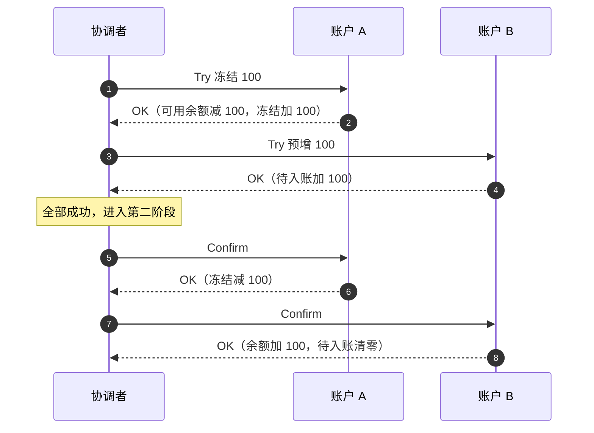
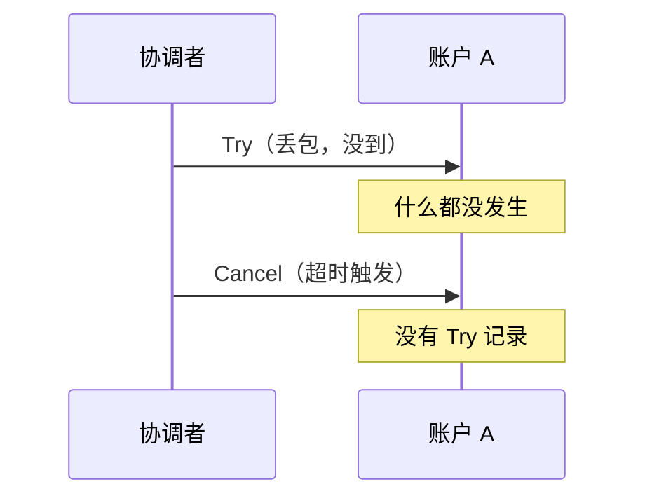
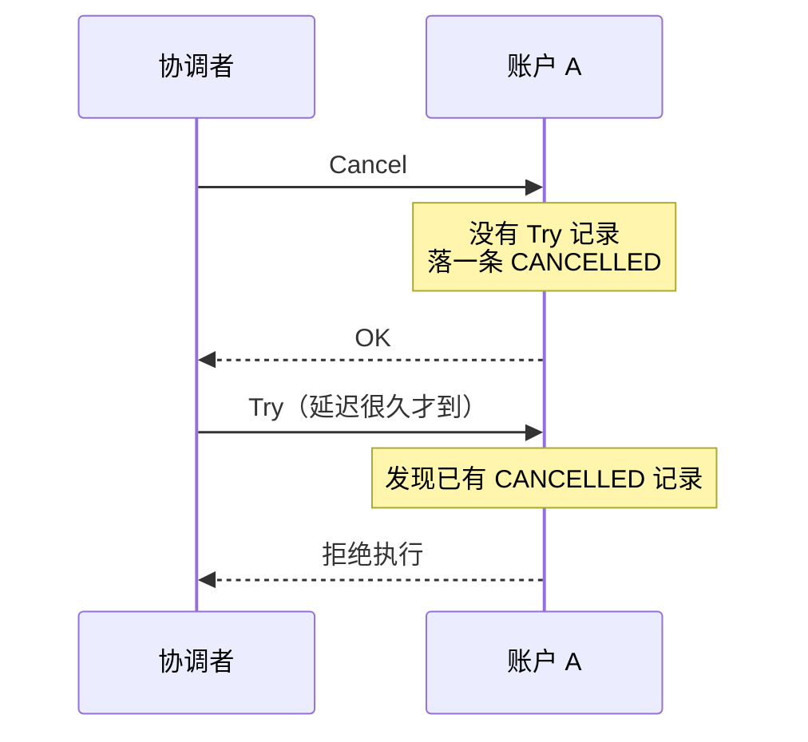

# TCC：三段式与三类异常

TCC 把一次分布式事务拆成三段：Try 预留资源，Confirm 真正使用，Cancel 释放预留。

正常情况很顺。麻烦全在异常上，尤其是网络超时和重试。

## 正常流程



Try 只做预留，不动真正的余额。所以中间状态对用户是可见的：可用余额少了，但还没转出去。

Confirm 和 Cancel 都必须幂等。协调者可能重试，也不能保证只调用一次。

## 三类异常

### 空回滚

Try 因为网络超时没到达，但全局事务已经超时，协调者开始发 Cancel。



如果直接按"回滚"处理，Cancel 会去释放一份从来没冻结过的资源，要么报错触发无限重试，要么改错数据。

正确做法是 Cancel 发现自己没有 Try 记录时，不报错，而是落一条"已回滚"的记录，然后返回成功。这样协调者能正常结束，不会一直重试。

### 悬挂

反过来。Cancel 已经执行完，Try 才姗姗来迟。



如果 Try 这时正常执行，资源就被冻结了，但整个事务已经结束，没有人会来 Confirm 或 Cancel。这份资源会一直挂着。

所以 Try 进来时要先查一次记录，发现已经回滚过就直接拒绝。

### 幂等

Confirm 和 Cancel 都可能被调用多次。同一笔扣款执行两次，钱就多扣了。

处理方式是记录状态，重复调用时直接返回成功，但不重复执行。

## 工程上的做法

建一张分支事务表：

```sql
CREATE TABLE branch_tx (
    global_tx_id BIGINT      NOT NULL,
    branch_id    BIGINT      NOT NULL,
    status       TINYINT     NOT NULL,   -- 1=TRYING 2=TRIED 3=CONFIRMED 4=CANCELLED
    updated_at   DATETIME    NOT NULL,
    PRIMARY KEY (global_tx_id, branch_id),
    UNIQUE KEY uk_branch (global_tx_id, branch_id)
);
```

唯一索引负责"同一笔分支事务只有一行"，状态字段负责"这行现在走到哪一步"。

四类请求对应的处理：

| 当前状态    | 收到    | 动作                                     |
| ----------- | ------- | ---------------------------------------- |
| 无记录      | Try     | 插入 `TRIED`，执行预留                   |
| 无记录      | Cancel  | 插入 `CANCELLED`，直接返回成功（空回滚） |
| `TRIED`     | Cancel  | 改成 `CANCELLED`，释放预留               |
| `CANCELLED` | Try     | 拒绝执行（悬挂）                         |
| `TRIED`     | Confirm | 改成 `CONFIRMED`，真正提交               |
| `CONFIRMED` | 任意    | 直接返回成功（幂等）                     |

这张表把三类异常都变成了"状态机上的一个判断"，不需要额外写三套特殊逻辑。

## 用状态机来理解

把上面那张表抽象一下，其实是两个状态：

```
Null ──Try──> Try ──Confirm──> Confirm
                 └──Cancel───> Cancel
```

以及两个"非法"的转移：

```
Cancel ──Try──> ✗    （悬挂）
Null   ──Cancel──> Cancel   （空回滚，直接进终态）
```

只要状态机允许 `Null → Cancel` 这条边，空回滚就不再是异常，而是一个正常转移。

只要状态机不允许 `Cancel → Try`，悬挂就自动被挡住。

幂等也不用单独处理。同一个状态下重复收到同一个消息，转移的结果不变。

## 用 TLA+ 验证这套设计

上面说的是设计意图。要确认它真的成立，可以写一个规约让 TLC 穷举所有执行顺序。

完整规约在 [examples/tcc/TCC.tla](../examples/tcc/TCC.tla)，跑法：

```
java -cp ~/tla2tools.jar tlc2.TLC -deadlock -config TCC.cfg TCC.tla
```

### 一个关键假设：不建模超时

规约里没有"超时"这个动作。

理由是：超时只是触发 Cancel 的一种原因，业务失败、人工干预、熔断打开，都会触发 Cancel。与其一个个建模，不如直接假设"Try 之后任意时刻都可以 Cancel"。这个假设更宽松，覆盖了所有具体情况。

```tla
RequestCancel ≜
    ∧ sended_try = TRUE ∧ sended_confrim = FALSE
    ∧ mailbox' = [node ∈ v_nodes ↦ mailbox[node] ∪ {Cancel}]
    ∧ sended_cancel = TRUE
    ∧ UNCHANGED ⟨receive_can, state, resource, v_nodes, sended_try, sended_confrim⟩
```

`RequestCancel` 只要求"Try 发过、Confirm 没发"，对时刻没有任何约束。

### 核心动作

`ResponseTry` 是唯一会产生副作用的地方：

```tla
ResponseTry(node) ≜
    ∧ Try ∈ mailbox[node]
    ∧ state[node] = Null
    ∧ IF Cancel ∈ mailbox[node]
      THEN
            ∧ state' = [state EXCEPT ![node] = Cancel]
            ∧ UNCHANGED ⟨mailbox, receive_can, resource, v_nodes⟩
      ELSE
            ∧ receive_can' = receive_can ∪ {node}
            ∧ state' = [state EXCEPT ![node] = Try]
            ∧ resource' = [resource EXCEPT ![node] = @ - 1]
            ∧ UNCHANGED ⟨mailbox, v_nodes⟩
    ∧ UNCHANGED ⟨sended_try, sended_confrim, sended_cancel⟩
```

两个 guard：`Try` 在收件箱里，`state` 还是 `Null`。

如果 `Cancel` 也在收件箱里（说明 Cancel 先到），直接把状态设成 `Cancel`，不扣资源。这就是空回滚。

如果 `state` 已经是 `Cancel`（说明 Cancel 执行过了），guard 不满足，动作不执行。这就是悬挂。

`mailbox` 是集合，重复投递不会累积，响应侧又靠 `state` 的 guard 挡住重复执行，所以幂等也不需要额外处理。

### 执行者为什么要先塞进 mailbox 再查

现实里，执行者收到一条 RPC，RPC 的类型就决定了它调哪个方法。是 Try 就调 `try()`，是 Cancel 就调 `cancel()`，类型写在消息里，不用猜。

规约里不是这样。消息先被塞进 `mailbox[node]`，响应动作再去集合里看现在有什么：

```tla
ResponseTry(node) ≜
    ∧ Try ∈ mailbox[node]
    ∧ state[node] = Null
    ∧ IF Cancel ∈ mailbox[node]
      THEN ...
      ELSE ...
```

这就是"一股脑塞进去，再回头看之前来过什么"。

为什么要这么写？

因为到达顺序不确定。如果写成"收到 Try 就直接调 `ResponseTry`"，等于默认了 Try 一定先到，那空回滚和悬挂就表达不出来。

把消息先放进集合，集合本身不关心顺序。响应动作再根据"集合里现在有什么"来决定行为：

- 只有 Try → 正常进入 Try
- Try 和 Cancel 都在 → 说明 Cancel 先到过，直接进 Cancel
- 只有 Cancel → `ResponseTry` 的 guard 不满足，不执行

同一个 `ResponseTry`，靠 `IF Cancel ∈ mailbox[node]` 这一个判断，覆盖了两种到达顺序。

这和现实里不一样，但覆盖的范围比现实大。多的能罩住少的。

### 三个 bool 补上"发过没有"

`mailbox` 是集合，集合不记顺序，也不记次数。所以另开了三个布尔变量：

```tla
RequestTry ≜
    ...
    ∧ sended_try' = TRUE

RequestConfrim ≜
    ∧ sended_try = TRUE ∧ sended_cancel = FALSE
    ...
    ∧ sended_confrim' = TRUE

RequestCancel ≜
    ∧ sended_try = TRUE ∧ sended_confrim = FALSE
    ...
    ∧ sended_cancel = TRUE
```

三条约束：

- Try 只能在最开始发一次
- Confirm 必须在 Try 之后，而且 Cancel 还没发
- Cancel 必须在 Try 之后，而且 Confirm 还没发

没有这三个 bool，集合分不清"Try 到底发过没有"，也拦不住"先 Confirm 再 Cancel"这种不合法的顺序。

它们不负责"只发一次"的幂等（那是应用层和各节点自己的事），只保证规约里的调用顺序是合法的。这是最低限度的顺序保证。

### 验证了什么

一共三条，都跑过。

活性：

```tla
Liveness ≜
    ∧ ◇□(∀ node ∈ v_nodes: resource[node] = 0)
    ∧ ∨ ◇□(∀ node ∈ v_nodes: state[node] = Confrim)
      ∨ ◇□(∀ node ∈ v_nodes: state[node] = Cancel)
```

资源最终全部归还，所有节点的状态最终统一收敛到 Confrim 或者全部收敛到 Cancel。

安全性：

```tla
ResourceBounded ≜ ∀ node ∈ v_nodes: resource[node] >= -1 /\ resource[node] <= 0
```

初始是 0，Try 之后是 -1，Confirm 或 Cancel 之后回到 0。如果某个节点被重复预留，就会掉到 -2，这条会立刻抓到。

状态单调性：

```tla
StateStable ≜
    ∀ node ∈ NODES:
        IF node ∈ v_nodes
        THEN ∧ (state[node] = Confrim ⇒ □(state[node] = Confrim))
             ∧ (state[node] = Cancel ⇒ □(state[node] = Cancel))
        ELSE TRUE
```

两个终态要分开写。如果合成一个：

```tla
(Confrim ∨ Cancel) ⇒ □(Confrim ∨ Cancel)
```

那"先 Confrim，之后再变成 Cancel，然后一直 Cancel"这条路径也会被判定为满足。因为它只要求之后一直在集合里，没要求停在哪一个。

分开写之后，这两条路径都被排除：已经 Confrim 的不能再变 Cancel，反过来也一样。

```
Model checking completed. No error has been found.
18 states generated, 9 distinct states found
```

### 没建模的部分

消息丢失没有单独建模，但它的后果已经被覆盖了。

消息丢失在规约里的表现只有两种：Try 没到，或者 Cancel 没到。第一种会走空回滚，第二种可以重发（`RequestCancel` 对时刻没有约束，想什么时候再发都行）。这两种情况都被 `mailbox` 是集合、`state` 是状态机这两点接住了。

规约真正假设的是"消息可能任意晚到，也可能永远不到"。这比"丢掉一条"更宽松，所以丢一条自然也在里面。

网络分区确实没写。分区不是丢一条消息，而是一段时间内完全失联，协调者可能会误判对方已经死了，转而去走 Cancel。要建模这个，得加一个"连接状态"变量，让消息在某些状态下根本发不出去。规约里没有这一层。

协调者崩溃和持久化也没建模。它们属于实现层面，靠发件箱、对账、幂等表兜底，不是状态机能解决的。

### 一个让步

`StateStable` 的量化域必须是常量。TLA+ 的时序属性不接受"域是变量"的量词，所以原来的 `∀ node ∈ v_nodes` 跑不起来，TLC 会报 `v_nodes is either undefined or not an operator`。

改成 `∀ node ∈ NODES` 之后，又会在初始状态访问到未定义的 `state[node]`，因为 `state` 的域只覆盖 `v_nodes`。

最后把 `Init` 里的 `v_nodes ∈ SUBSET NODES \ {}` 改成了 `v_nodes = NODES`，让所有节点都参与，才跑通。

代价是不能再枚举"任意规模的参与者集合"，只能验证"全部节点参与"这一种情况。要保留枚举，得把 `state`、`mailbox`、`resource` 的域都改成 `NODES`，`v_nodes` 只用来标记哪些节点参与。改动会大一些，暂时没做。

另外，规约没有建模消息丢失、网络分区、协调者崩溃。这些属于工程实现层面，靠发件箱、对账、幂等表兜底，不是状态机本身能解决的。
