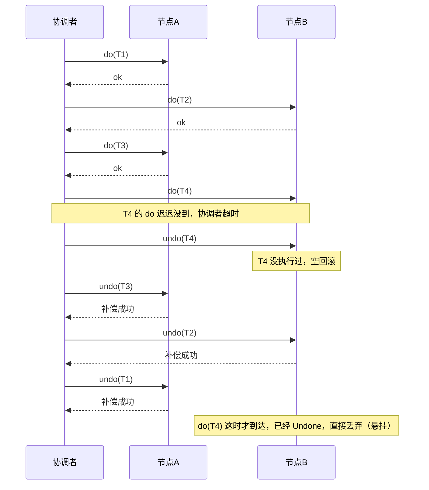

# Saga：长事务补偿

与 TCC 不同的是，TCC 是先看看大家都能不能做，如果能做的话才执行。Saga 是每个人依次先做了再说，如果其中有一个人失败了，就开始逆序补偿。

## 软状态

因为 Saga 这种先试着做再说的特点，所以会导致几乎全程的软状态。为了保护这些软状态，通常给数据库表额外加一个状态字段，用于表示是否在 Saga 期间，查询的时候过滤掉 Saga 期间的状态。

当资源的更改涉及到其他节点时候，软状态并不只保护一方，而是双方都需要保护。比如 Saga 中 A 向 B 转移了资源，但是却只保护了 A，然后 B 的资源又被转移或消耗了，那么 Saga 补偿的时候就会凭空多出了资源，或者无法补偿。

但是结束 Saga 状态这个动作，只能由协调者来实行，如果此时的网络出了问题，可能会导致状态字段一直处于 Saga 状态，所以需要约定超时时间，超时之后自动取消自身的 Saga 状态。此时间窗口应大于从首个 Saga 执行开始的超时时间。

这么在外界看来，Saga 和 TCC 似乎别无二致。

## 和 TCC 的区别

所以 Saga 和 TCC 的区别就在于实现的思路与难度上了。在 TCC 中提到过，为了实现 TCC，我们必须把一个操作拆分成 Try-Confirm-Cancel 三个阶段，这对业务的侵入性是极大的，且 TCC 在同一个节点上只执行一次流程。

反观 Saga，只需要编写一个补偿的方法即可，在无法修改源码的情况下具有显著的优势，符合开闭原则。且 Saga 可能多步都在同一个节点上。

代价就是补偿不一定成功。不过有了软状态保护之后，因为技术原因导致的补偿失败概率会大大降低。

在执行 Saga 的时候，越重要的东西应该越提前。补偿是逆序的，越早执行的越晚被撤。

TCC 一样，Saga 也会面临空回滚和悬挂的问题，处理方法与 TCC 一致。

## 用 TLA+ 验证这套设计

### 步骤怎么分给节点

步骤在节点上怎么分布不能写死。写死了就只验证一条固定路径，换成另一种分布，可能就有问题冒出来。

但"任意分配"这句话在 TLA+ 里不好直接写。最直觉的是给每个节点声明一组步骤：

```tla
node_to_step ∈ [NODES → SUBSET STEPS]
```

这样能表达"节点 A 有 T1 和 T3，节点 B 有 T2"。可是光这一条不够，TLC 会认为"T1 同时属于 A 和 B"也合法，一个步骤被两个节点抢着做，这不是业务上允许的。

"T3 谁都不属于"倒是允许的，等于这次只用到 T1 和 T2。配几个步骤是常量决定的，同一份规约换个配置就能测不同数量的 T。

问题是 TLA+ 的集合没有计数。两个集合做并集，重复的元素会被吃掉，看不出来它出现了两次。所以要用多重集：

```tla
RECURSIVE MergeSetToBag(_)
MergeSetToBag(nodes) ≜
    IF nodes = {}
    THEN EmptyBag
    ELSE LET node ≜ CHOOSE x ∈ nodes: TRUE
         IN SetToBag(node_to_step[node]) (+) MergeSetToBag(nodes \ {node})
```

把每个节点的集合转成 bag，一个个合起来。合完看每个元素出现了几次：

```tla
∧ MergeSetToBag(NODES) ≠ EmptyBag
∧ ∀ count ∈ Range(MergeSetToBag(NODES)): count = 1
```

`count = 1` 就是"同一个步骤不会被两个节点认领"，重复的被挡住了。

没人认领的步骤不在任何一个 bag 里，计数检查碰不到它。这是故意的，正好用来表达"有些步骤这次用不到"。所以标号只针对被认领的步骤：

```tla
UsedSteps ≜ DOMAIN MergeSetToBag(NODES)
```

`last_step` 的范围和 `order_to_step` 都基于 `UsedSteps`，不是整个 `STEPS`。配五个步骤、实际只用三个，也能跑。

节点那边不受限制，可以零个步骤，也可以有好几个。TLC 会把所有分配方式都枚举一遍。

发消息的时候要按步骤找节点，这个映射直接算出来就行，不用再声明一个变量：

```tla
StepToNode ≜ [s ∈ UsedSteps ↦ CHOOSE n ∈ NODES: s ∈ node_to_step[n]]
```

### 直接选在第几步失败

现实里协调者是走到第 k 步失败，才知道要开始补偿的。模型里不这么写，在 Init 里就把失败点定下来：

```tla
∧ tx_type ∈ {CanDoAll, NeedUndo}
∧ IF tx_type = NeedUndo
  THEN last_step ∈ 1‥Cardinality(UsedSteps)   \* 在第几步失败
  ELSE last_step = Cardinality(UsedSteps)
```

`CanDoAll` 就是一路走到底，`NeedUndo` 就是走到 `last_step` 之后开始往回撤。

这么写不是在模拟现实，是切分验证空间。结局只有有限的几种：全部成功，或者在第一步失败，或者在第二步失败，一直到第 n 步。每种固定一次，分几次验证。所有路径都会落在其中一种，分开验证就等于合起来验证。

好处是 `Next` 里不用写"如果失败就转补偿"这种分支，每个场景是一条独立的搜索路径。出问题的时候也好看，反例直接告诉你是第几步失败的。

代价是公共前缀被重复搜索。n+1 个场景各自从 Init 走到自己的失败点，前面的步骤算了很多遍。所以总状态数不一定比"先做再按结果分支"少。

这和 TCC 那篇里 `tx_type` 是一回事，都是把运行时的分支搬到 Init 里。TCC 分的是 Confirm 和 Cancel，Saga 分的是全部成功和第 k 步失败。

### 消息和执行要分开

协调者发 do，节点处理 do，这是两个动作。

```tla
AdvanceDoing ≜
    ∧ will_do ≤ last_step
    ∧ IF will_do = 1
        THEN TRUE
        ELSE step_state[order_to_step[will_do - 1]] ∈ {Done, Undone}
    ∧ LET step ≜ order_to_step[will_do]
      IN  ∧ ¬(∃ x ∈ inbox[StepToNode[step]]: x.type = Undo)
          ∧ inbox' = [inbox EXCEPT ![StepToNode[step]] =
              @ ∪ {[type |-> Do, step |-> step]}]
          ∧ will_do' = will_do + 1
```

`inbox` 就是收件箱。协调者写进去，等于把消息放到了执行者的收件箱里，节点再从里面按顺序取。如果发送和执行合成一个动作，到达乱序就表达不出来了。

那个 `¬(∃ ... Undo)` 是说，同一个节点上如果有还没处理的 undo，就先别发 do。发 undo 的时候也有一条对称的，要求没有待处理的 do。两条合起来，同一个步骤的 do 和 undo 不会同时停在队列里。

中间那个判断是串行的来源。第 `will_do - 1` 步做完，或者已经被撤了，才允许发第 `will_do` 步。第一步没有前驱，跳过。

"已经被撤了"也要放行，因为协调者不知道对面的 do 还没到。它按顺序发，发到第 k 步的时候，前面几步在它眼里都是成功的。有的可能还在路上，undo 先到就被空回滚掉了，状态是 `Undone`，但协调者照样往下发。

不写这一条，协调者可以一口气把四条 do 全发出去，全都堆在队列里。跑 TLC 也能通过，但那个模型里四步是并行执行的，不是 Saga。

不过这一条只保护到倒数第二步。最后一步没有下一步来约束它，而且 `will_do = last_step` 的时候 undo 已经能发了。所以如果只加这一条、不加互斥，最后一步的 do 和 undo 还是会同时在收件箱里。互斥那两条就是补这个缺口的。

试过只留串行、去掉互斥，`NoHandleDoAndUndo` 立刻违反，反例里 `last_step = 1`，do 发出去之后 `will_do` 变成 2，undo 的条件也满足了，两条就并排躺在收件箱里。

这里和 TCC 的手法不一样。TCC 的分支事务之间没有先后关系，A 的 Try 和 B 的 Try 谁先谁后都不影响结果，所以按节点拆开、各自独立投递就够了。Saga 有顺序，必须一条一条来。

补偿的方向反过来，从 `last_step` 递减到 1：

```tla
AdvanceUndoing ≜
    ∧ tx_type = NeedUndo
    ∧ will_undo ≥ 1
    ∧ (will_do = last_step ∨ will_do = last_step + 1)
    ∧ IF will_undo = last_step
        THEN TRUE
        ELSE step_state[order_to_step[will_undo + 1]] = Undone
    ∧ LET step ≜ order_to_step[will_undo]
      IN  ∧ ¬(∃ x ∈ inbox[StepToNode[step]]: x.type = Do)
          ∧ inbox' = [inbox EXCEPT ![StepToNode[step]] =
                @ ∪ {[type |-> Undo, step |-> step]}]
          ∧ will_undo' = will_undo - 1
```

### 每步一个状态机

最初写的时候状态是按节点记的，一个节点一个可见/不可见。写到响应函数的时候就卡住了，因为空回滚和悬挂都是针对某一步的，而一个节点上可能挂了好几个步骤，用节点的状态分不清是哪一步。

改成每步一个状态，三个值：

```
Null    没做过
Done    做完了
Undone  回滚过了
```

响应 do 的时候看这个状态：

```tla
∧ IF step_state[row.step] = Null
    THEN ∧ step_state' = [step_state EXCEPT ![row.step] = Done]
         ∧ resource' = [resource EXCEPT ![row.step] = @ - 1]
    ELSE ∧ UNCHANGED ⟨step_state, resource⟩
```

三种情况被这一个判断分开了：

- `Null`，正常执行
- `Done`，重复消息，出队就行（幂等）
- `Undone`，do 迟到了，吞掉（悬挂）

响应 undo 的时候也一样：

```tla
∧ IF step_state[row.step] = Done
    THEN ∧ step_state' = [step_state EXCEPT ![row.step] = Undone]
         ∧ resource' = [resource EXCEPT ![row.step] = @ + 1]
    ELSE ∧ step_state' = [step_state EXCEPT ![row.step] = Undone]
         ∧ UNCHANGED resource
```

- `Done`，正常补偿，资源还回去
- `Null`，空回滚，资源不动，只把状态改成 `Undone`
- `Undone`，重复消息（幂等）

空回滚的时候资源不变，但要记住"这一步已经撤过了"。不记的话，后面迟到的 do 会被当成第一次执行，悬挂就漏了。

这里有个容易走错的地方。一开始想的是"do 来的时候看看 inbox 里有没有对应的 undo，有就直接标记处理完"。问题是 undo 可能还在路上，马上就到。这时候 do 该正常执行，等 undo 来了再补偿。判断依据只能是这一步的状态，不能是队列里有没有某条消息。

### 什么时候能开始撤

补偿是逆序发起的。发起之前要定两件事：什么时候能开始，撤的时候要不要等。

先说开始。

TCC 那边没有这个问题。Cancel 到达时，Try 可能已经处理了，也可能还没。两种都能接：Try 做了就正常解冻，Try 没做就空回滚。所以 TCC 的 Cancel 是宽松的，谁来都接，因为分支事务之间没有顺序，不用等谁。

Saga 有顺序，前面那些步骤必须等。第 2 步没做完就撤第 1 步，撤到一半第 2 步又成功了，账就乱了。

前面那节的串行约束保证了一点：第 k 步能发出去，说明第 k-1 步已经有结论了，要么 `Done`，要么 `Undone`。两种都行，因为 `Undone` 表示它的 do 还没到、先被撤了，协调者并不知道。

唯一不确定的是最后一步。它的 do 可能还在路上，协调者等不到响应，直接开始撤。

所以条件是两个之一：

```tla
∧ (will_do = last_step ∨ will_do = last_step + 1)
```

`will_do = last_step`，说明最后一步的 do 还没到节点。`will_do = last_step + 1`，说明发了，但可能还在队列里没处理。

前者是直接往收件箱里塞 undo，等于让执行者先收到 undo。协调者不知道自己该不该等，所以干脆不等。

不能再早。`will_do` 要是停在 `last_step - 1`，说明倒数第二步都还没发，undo 先到就撤了一个从没尝试过的步骤。所以最多提前到最后一步。

也不能等所有 do 都处理完。最后一步可能永远等不到结果，硬等就卡死了。

再说撤的顺序。

补偿本身也要串行。后一步撤完，才能撤前一步：

```tla
∧ IF will_undo = last_step
    THEN TRUE
    ELSE step_state[order_to_step[will_undo + 1]] = Undone
```

第一条不用等，它是第一个撤的。后面的都要看后一步有没有变成 `Undone`。

这条是后加的。之前补偿是乱序发出的，会出现"第 1 步撤了、第 3 步还没撤"的中间状态。现实里协调者是一条一条发的，不会这样。

还有个条件，发 undo 之前要求目标节点没有待处理的 do：

```tla
∧ ¬(∃ x ∈ inbox[StepToNode[step]]: x.type = Do)
```

配合发 do 那节的对称条件，同一个步骤的两条消息不会同时停在队列里。

这件事单独拿出来当不变式验证过：

```tla
NoHandleDoAndUndo ≜
    ∀ node ∈ NODES: ∀ step ∈ STEPS:
        ¬({[type ↦ Do, step ↦ step], [type ↦ Undo, step ↦ step]} ⊆ inbox[node]
          ∧ step_state[step] = Null)
```

意思是：不可能出现"同一个步骤的 do 和 undo 都在队列里，而且这一步从来没处理过"。

为什么这条成立？因为节点收到一条就处理一条。要么先收到 do，处理完再收到 undo，是正常补偿；要么先收到 undo，处理完再收到 do，是空回滚加悬挂。两种顺序都不会让两条消息同时在队列里排队。

### 探针

TLC 报"没有错误"的时候，有两种可能：系统是对的，或者模型里根本走不到那个场景。

第二种最坑。假如 guard 写死了，空回滚永远出不来，TLC 一样报没有错误。这时候说"我验证了空回滚"，是句空话。

所以不变式可以反过来用。

正常的不变式写"应该一直成立的事"，违反了说明有 bug。反过来写"我觉得不该发生的事"，违反了说明这件事真能走到。被违反不是失败，是结果符合预期。

这个模型写了三条：

1. 前面的步骤不出现"没做过就回滚"。期望不被违反，说明串行约束确实挡住了
2. 任何位置都不出现"没做过就回滚"。期望被违反，说明最后一步的空回滚还留着
3. do 还在队列里，但这一步已经回滚了。期望被违反，说明悬挂还留着

光看当前状态分不出 `Undone` 是哪来的：做过又撤是 `Undone`，没做就撤也是 `Undone`。要加一个布尔记"曾经做过没有"，在 do 真正执行的时候置上。

这个变量只加在探针版里。正式版没有它，因为它不改业务，只改我们的观察。

探针跑完就删，留在文件里会让人以为它是业务的一部分。

>  这套探针是 AI 写出来的。我自己还没在项目里真正用过，只是看它跑通过几回，后面会找机会用起来。

### 验证了什么

四条不变式：

- 每个步骤的资源在 1 到 2 之间，而且和状态严格对应。`Done` 的时候是 1，其余是 2
- `cost` 恰好等于当前处于 `Done` 的步骤数，补偿一次就减一次，记账不会错
- 走到 Finish 的时候，每个步骤的终态符合 Init 里选的那个结局
- 同一个步骤的 do 和 undo 不会同时停在队列里，`NoHandleDoAndUndo`

一条属性：不管怎么乱序，最终一定会走到 Finish。

2 个节点 3 个步骤的配置，生成 1116 个状态，去重后 944 个。3 个节点 3 个步骤，生成 3222 个，去重后 2646 个。

### 没建模的部分

消息永久丢失没建模。每个发送动作都加了 `WF_vars`，只要一直可执行，最终一定执行。所以模型里不存在"消息永远不到"，只有"到得晚"。

补偿本身失败也没建模。undo 在模型里总是成功的。现实里补偿可能失败，靠重试、对账、人工介入兜底，这些不是状态机能解决的。

协调者崩溃、持久化、网络分区都没写。它们属于实现层面，跟 TCC 那篇是同一批问题。

## 执行时序


