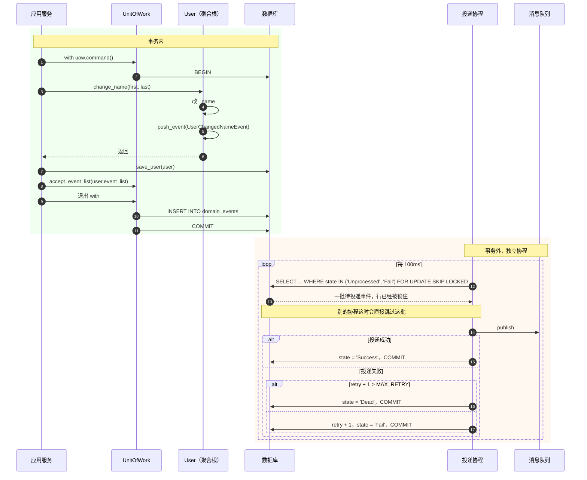
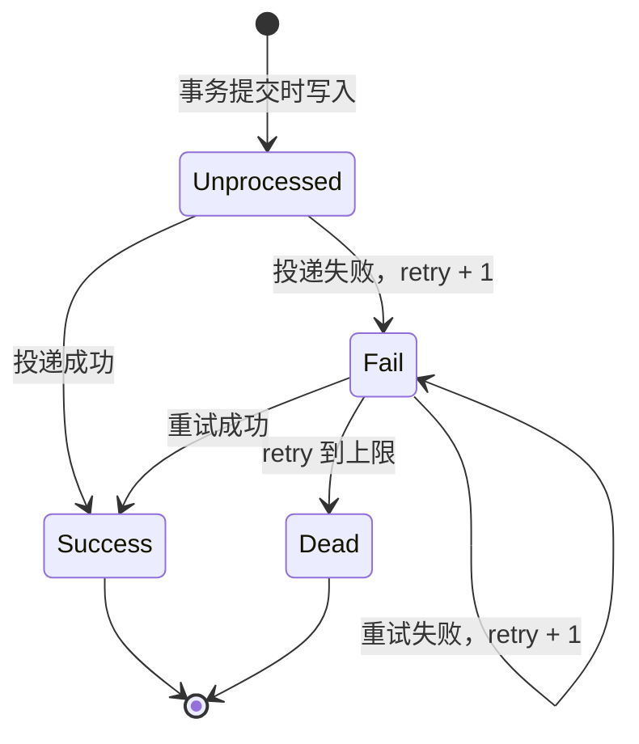

# Outbox：事务发件箱模式

> 刚开始写这一篇的时候，我本来想着的是对于 Outbox 我已经够熟悉了，没想到随着进一步的推演，发现了很多之前没有留意过的细节。

此模式的介绍这里就不再赘述了，参见 [为什么不用全自动的 UoW](../01-ddd/03-uow-tradeoff.md)。事件列表挂在聚合根上、事务退出前统一写进表，那篇里说过。

这里只说落地时候的细节和边界情况。

## 一次投递的完整流程



## 状态：四种就够

一开始我把事件分成五种：未被处理过（Unprocessed）、处理中（Processing）、失败（Fail）、成功（Success）、死信（Dead）。

但是随即我就发现，Processing 似乎是不必要的。

读出来再写 Processing 来占位，中间有个读-写窗口，在这个窗口里别的协程完全可以读到同一条，照样重复投递。

如果用了写锁，那写 Processing 也没必要了，读取的时候直接跳过被锁住的行就行。

上锁时间太长怎么办？这里无所谓。其他人没有读被锁住行的需求，而且只是投递到消息队列，占用时间不会很长。

去掉之后剩四种：



> 不过用了 FOR UPDATE 必须给 state 加索引，否则在 RR 下会锁整张表（行级/间隙级锁，但效果上基本等同于锁全表）。

## 先投递还是先查 retry

retry 代表到目前为止的重试次数，初始化为 0。投递失败且当前 retry = MAX_RETRY 时，代表重试次数到达上限，移入死信。

但是如果先看 retry 再决定要不要投递，那么在 retry = MAX_RETRY - 1 时尝试最后一次，假设最后一次失败了，理论上应该移交死信队列，但是仍需要等到下一次遍历。

所以选用先投递再检查的方式，消除最后一个重试-检查的时间窗口。

## 先投递还是先改状态

先投递。投递完但是没有改状态，崩溃恢复之后只是会重复投递，消费者一侧用去重表、唯一键、状态机做幂等就行。

反过来，如果先改状态，崩溃再恢复后就不会尝试投递这个事件了。

但是一次拿一批事件，所以也只能一批投递完之后再改一批的状态。一次崩溃是一批的状态都没被更新，可能带来额外的一次重试。概率不大，影响也不坏。

## 用 TLA+ 验证

### 从哪开始建模

在规约里，直接从"任意时刻可以向数据库内写入任意数量的事件"开始。没落库成功的话，后果显而易见，不参与后面的过程。这等同于"任意时刻的接下来一小段时间内，不被打断地连续插入一条事件"，建模后者就够。

为了实现多个协程抢事件的效果，需要把读、执行、写分开。

### 三个变量

`table` 是数据库那张表，一堆事件记录。

另外两个按协程分开：

```
before[g]    这个协程读出来、还没出结果的事件
after[g]     已经出了结果、还没写回表的事件
```

为什么要拆成两份。投递是"读、执行、写"三步，中间可能崩溃。只留 `before`，崩溃后分不清改没改；只留 `table`，还没写回去的东西看不见。两个变量刚好把两个中间态都摆出来。

### 四个动作

写事件：

```tla
WriteEventToTable ≜
    ∧ table' = table ∪ {[uid ↦ uid, state ↦ Unprocessed, retry ↦ 0]}
    ∧ uid' = uid + 1
```

读一批：

```tla
ReadFromTable(goroutine) ≜
    ∧ before[goroutine] = {} ∧ after[goroutine] = {}
    ∧ before' = [before EXCEPT ![goroutine] =
          {event ∈ table:
              ¬(∃ g ∈ GOROUTINES:
                  (∃ x ∈ before[g]: x.uid = event.uid)
                  ∨ (∃ x ∈ after[g]: x.uid = event.uid))
              ∧ event.state ∈ {Unprocessed, Fail}}]
```

`before[goroutine] = {} ∧ after[goroutine] = {}` 是自己上一批还没处理完就不能再读，一个协程串行处理。

过滤条件把所有协程 `before` 和 `after` 里的 uid 都排掉。表里没有"被占用"这个字段，占用是靠这两个变量表达的，效果等同于 `SELECT ... FOR UPDATE SKIP LOCKED`。

投递：

```tla
Submit(goroutine) ≜
    ∧ before[goroutine] ≠ {}
    ∧ ∃ event ∈ before[goroutine]:
        ∧ before' = [before EXCEPT ![goroutine] = @ \ {event}]
        ∧ ∃ ok ∈ BOOLEAN:
            ∧ IF    ok
              THEN  after' = [after EXCEPT ![goroutine] =
                        @ ∪ {[event EXCEPT !.state = Success]}]
              ELSE  IF event.retry = MaxRetry
                    THEN  after' = [after EXCEPT ![goroutine] =
                              @ ∪ {[event EXCEPT !.state = Dead]}]
                    ELSE  after' = [after EXCEPT ![goroutine] =
                              @ ∪ {[event EXCEPT !.state = Fail, !.retry = @ + 1]}]
            ∧ UNCHANGED ⟨table, uid⟩
```

`∃ ok ∈ BOOLEAN` 表示投递可能成功也可能失败，不指定概率，两个分支都要能走到。

写回：

```tla
UpdateEventToTable(goroutine) ≜
    ∧ before[goroutine] = {} ∧ after[goroutine] ≠ {}
    ∧ table' = (table \ {old ∈ table:
            ∃ fresh ∈ after[goroutine]: old.uid = fresh.uid})
        ∪ after[goroutine]
    ∧ after' = [after EXCEPT ![goroutine] = {}]
```

先删同 uid 的旧记录再合并，等于用新状态覆盖旧的。

### 不变式

```tla
CannotReadTheSameOne ≜
    ∀ g1 ∈ GOROUTINES: ∀ g2 ∈ GOROUTINES \ {g1}:
        {x.uid: x ∈ before[g1]} ∩ {x.uid: x ∈ before[g2]} = {}
```

另外三条把 `before` 和 `after` 换一下位置，一共四种组合。要验的就是一件事：任何两个协程不会同时拿着同一条事件。

### 活性

```tla
SuccessOrDead ≜ ◇□(∀ event ∈ table: event.state ∈ {Success, Dead})
```

所有事件最终要么成功，要么进死信，不会永远停在 Unprocessed 或者 Fail。

这条要靠 `WF_vars` 撑。每个动作都加了公平性，否则可能出现某个协程一直不被调度，事件就永远躺在 `before` 里。

### 那些坑

**`@ \ event` 要写成 `@ \ {event}`。**

`\` 是集合差，右边必须是集合。`event` 是单条记录，写错了 TLC 报的是 `is in the record`，看着像语法错，其实是类型错。

**过滤要按 uid 比，不能拿整条记录比。**

`event ∈ after[g]` 比的是整个 record。`after` 里那条已经改成 `Fail` 了，和表里的 `Unprocessed` 不相等，`∈` 返回假，等于没跳过，两个协程会读到同一条。

### 全链路的最后一步

因为消费者端可能会一直失败，所以可能会出现投递成功了但是消费失败的情况，所以每天凌晨等低峰期需要去对账找投递成功却消费失败/死信队列里的事件，一起移交给人工处理
