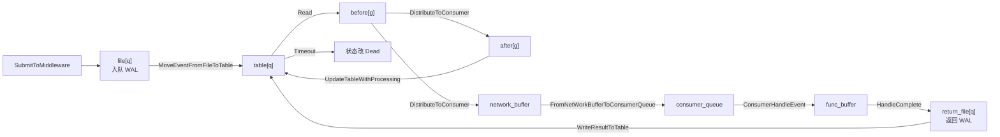
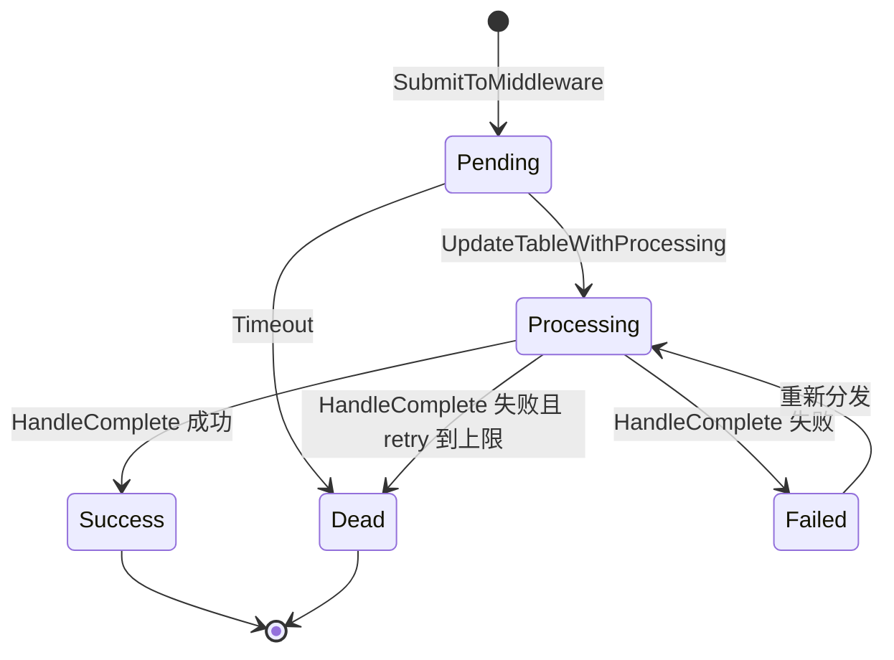

# 一个消息队列规约的解读

这份规约在 [light-mq](https://github.com/SumengQAQ/light-mq) 的 `spec/` 下。挑它来讲，是因为它不算大，十来个动作，几条不变式，但该有的东西都有：缓冲区、状态机、去重、超时、冻结，一个不缺。

跑完是 2.5 亿个去重状态，深度 86。

读规约和读代码不太一样。代码从 main 进去，跟着调用走一遍大概就知道在干嘛。规约没有入口，它描述的是“所有可能发生的事”，你得先找到那个集合，再看哪些被排除了。

下面按三遍读。

## 第一遍，只看骨架

TLA+ 模块永远是五段：

```
常量、变量      系统里有什么
Init            初始状态
动作            状态怎么变到下一个
Next            所有动作的析取
Spec            Init ∧ □[Next]_vars ∧ 公平性
```

第一遍别管动作内部的守卫，只把变量列出来，画一张图：谁在变，谁把谁传给谁。

这份规约的变量：

```
uid             自增计数器
file[q]         每个队列一个 WAL
table[q]        每个队列一张表
return_file[q]  返回结果的 WAL
cache           入队去重 + 每组最大序号
consumer_cache  消费端去重
before[g]       分发协程手上的一组
after[g]        同上，处理完待写回
network_buffer  发出去了还没到
consumer_queue  到了还没开始处理
func_buffer     正在处理
frozen          组的 uid 快照
```

十二个，看着多，其实是四条链路：



画完回头看动作名，基本能对上。入队是 `SubmitToMiddleware` 和 `MoveEventFromFileToTable`，分发是 `Read` 和 `DistributeToConsumer`，消费是 `ConsumerHandleEvent` 和 `HandleComplete`，返回是 `WriteResultToTable`。

多出来两个：`Timeout` 管卡住的组，`AllEventInTerminal` 管停。

状态还不够，事件自己在走一个状态机：



`Success` 和 `Dead` 是终态，进去了就不出来。这一点后面写不变式的时候要用到。

这一步做完，系统的大致形状就有了。剩下的是“为什么这么切”。

## 第二遍，找不变式

不变式是规约里最值钱的部分。它说的是：这些状态下，系统一定是对的。

挂了三条约：

```
FrozenStable     冻结之后，一组的事件不会被拆到两个地方
ConsistentState  同一组的事件状态一致
UidOnlyOnce      一个 uid 在表里只有一行
```

读不变式的时候，先问它排除了什么状态，不排除会怎样。

拿 `UidOnlyOnce` 说：

```tla
∀ q ∈ QUEUE:
    Cardinality(table[q]) = Cardinality({x.u: x ∈ table[q]})
```

左边是行数，右边是不同的 uid 个数。相等就是“没有重复的 uid”。

写这条之前，`table` 里确实会重复。原因是 `return_file` 只追加：一组失败一次、成功一次，就写进去两批。落库时如果直接把两批并进表里，同一个 uid 就有两行，一行 `Failed` 一行 `Success`。

麻烦在于，后面所有不变式都得考虑两行的情况。比如“一组只有一种状态”这条直接写不出来，因为表里真的会 `Failed` 和 `Success` 并存。

解决办法是落库之前按 uid 挑一条，终态优先，没有终态就挑 retry 最大的。挑完 `UidOnlyOnce` 才成立，其他不变式也好写了。

这段过程在仓库的 ADR 里，比读规约本身有意思，因为它讲的是“为什么会有这条不变式”，而不是“这条不变式是什么意思”。

## 第三遍，看公平性

`Spec` 最后几行是 `WF_vars(...)`。

```tla
Spec ≜
    ∧ Init
    ∧ [][Next]_vars
    ∧ WF_vars(SubmitToMiddleware 那一串)
    ∧ WF_vars(MoveEventFromFileToTable)
    ...
```

`WF` 的意思是：一个动作从某一刻起一直可执行，那它最终会被执行。

没有它会怎样？模型里可以一直不执行某个动作，事件永远躺在 file 里，最后也“符合规约”。因为规约只说“可以做”，没说“必须做”。

活性 `FinalConvergence` 就是靠 `WF` 撑的：

```tla
FinalConvergence ≜ ◇□(∀ q ∈ QUEUE: ∀ e ∈ table[q]: e.state ∈ Terminal)
```

最终所有事件都到终态。没有 `WF_vars(Timeout)`，卡住的组可以永远卡着，这条就不成立。

`AllEventInTerminal` 那个动作看着奇怪，其实是为了防死锁。所有事件到终态之后，其他动作全不可执行，TLC 会判成死锁。加一个“到这一步允许停住”的空动作，它就不报了。

## 几个具体的坑

### CHOOSE 和 ∃ 不一样

`CHOOSE x ∈ S: P(x)` 返回一个值，`∃ x ∈ S: P(x)` 返回真假。

写状态迁移要的是“从 S 里任选一个”的那种不确定性，得用 `∃`：

```tla
∃ x ∈ S: v' = x
```

用 `CHOOSE` 只有一条路径，模型只检查了其中一个值。

`CHOOSE` 适合写辅助函数，比如“从这组事件里挑一条取它的 queue 字段”，那里不需要分叉。

### 时序公式外面的量词，域必须是常量

第一次写活性的时候直接报错：

```tla
∀ event ∈ table[q]: ◇□(event.state ∈ Terminal)
```

`table` 是变量，TLC 没法把公式编译成自动机，因为量词域每一层状态都不一样。

改成：

```tla
◇□(∀ q ∈ QUEUE: ∀ e ∈ table[q]: e.state ∈ Terminal)
```

时序操作符放最外面，量词进到谓词里面。

规律是 `□` 和 `∀` 可以交换，`◇` 不行。`□(∀ x: P)` 和 `∀ x: □P` 等价，`◇(∀ x: P)` 和 `∀ x: ◇P` 不等价。所以要么量词域是常量，要么把 `◇` 放外面。

### 变量同时被赋值和 UNCHANGED

```tla
∧ table' = ...
∧ UNCHANGED ⟨..., table, ...⟩
```

两句都在说 table，一句说它变了，一句说它没变。TLA+ 不管这个矛盾，语法照样过，但动作永远不可执行。

遇到这个是因为把冻结拆成了独立动作，和落库用 `∧` 拼在一起。两个动作各自约束 table，拼起来就冲突。

解决办法是合并成一个，或者让其中一个不再约束那个变量。

## 最后

这份规约现在能跑，但没验活性。要验的话把 `FinalConvergence` 加进 cfg 的 `PROPERTY`，状态空间还要再翻一倍。

还留了一条没写的不变式，因为有个竞态窗口不好表达：`return_file` 里已经是 `Success`，但还没落库，数据库里那一行还是 `Failed`。这个窗口里“要么在表里是终态，要么在 WAL 里是终态”是假的，业务上没事，消费者有去重，但写不成一条干净的不变式。
