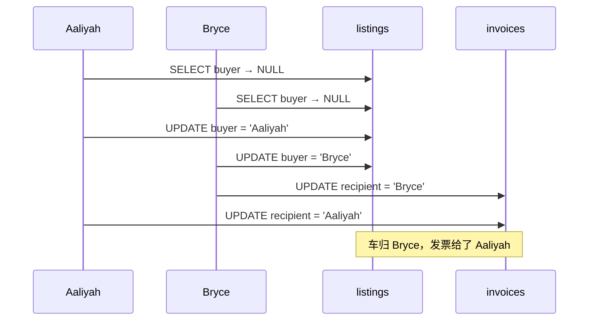
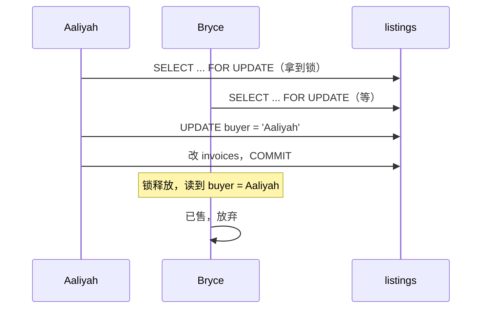
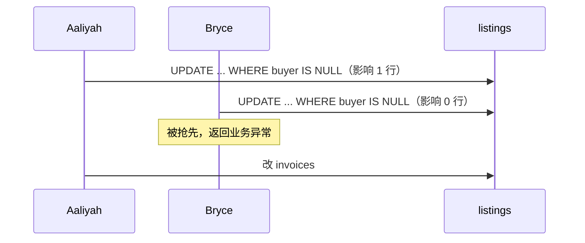
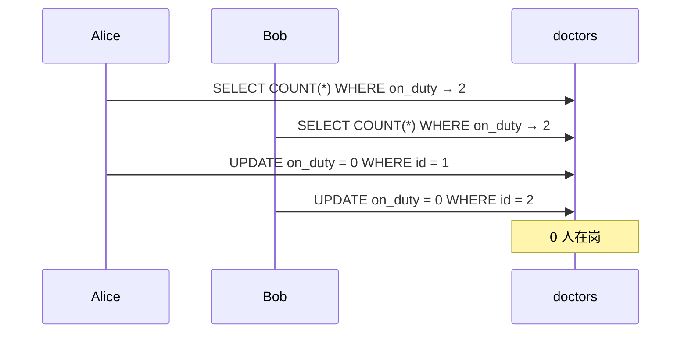
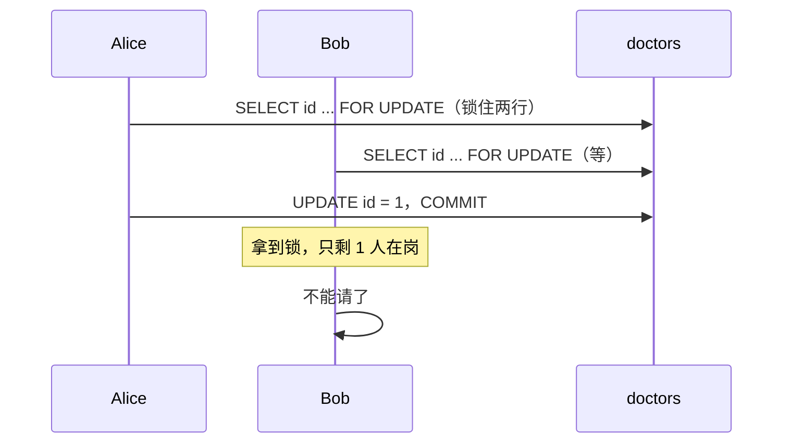
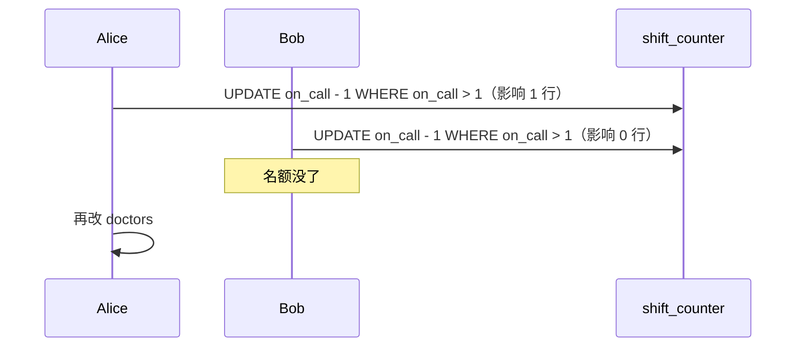
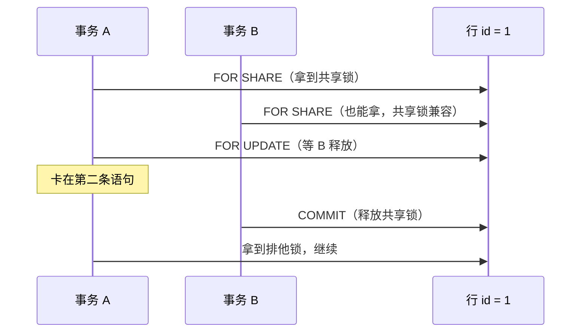
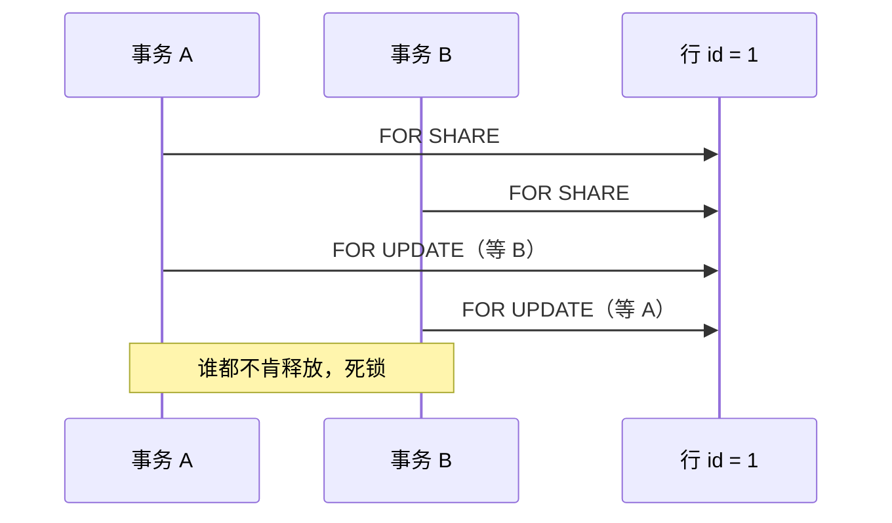

# 数据库中的事务

此文中数据库默认指 MySQL，本人对其余数据库了解有限。

对关系型数据库来说，ACID 里的 C（一致性）在 MySQL 上很大一部分是靠 MVCC 和锁实现的。

先复习隔离级别。

## 隔离级别

| 隔离级别 | 脏读 | 不可重复读 | 幻读            |
| -------- | ---- | ---------- | --------------- |
| 读未提交 | 可能 | 可能       | 可能            |
| 读已提交 | 不会 | 可能       | 可能            |
| 可重复读 | 不会 | 不会       | InnoDB 基本不会 |
| 可串行化 | 不会 | 不会       | 不会            |

**读已提交**：每条语句执行时新建一个视图。所以同一个事务里两次读，中间别人提交了，第二次就能看到新值。

**可重复读**：视图在事务第一次读的时候建立，之后一直用这个。别人的提交不影响自己的快照读。

但普通 SELECT 只是快照读，不加锁。`SELECT ... FOR UPDATE` 这种当前读会加锁，InnoDB 在 RR 下会加间隙锁，所以幻读基本被挡住了。

## MVCC

一行数据在磁盘上留多个版本，用指针串起来：

```
新版本 → 旧版本 → 更旧的版本
```

每个事务只能看见其中一部分。

InnoDB 在事务第一次读的时候建一个 **Read View**，里面记着：

```
m_ids        当前所有活跃（没提交）的事务 ID
min_trx_id   m_ids 里最小的
max_trx_id   下一个要分配的 ID
creator_trx_id  自己的 ID
```

判断某个版本可不可见，拿它的 `trx_id` 去比：

```
trx_id < min_trx_id        可见，建 Read View 之前就提交了
trx_id >= max_trx_id       不可见，我之后才开始的事务
trx_id 在 m_ids 里          不可见，还活着
trx_id == creator_trx_id   可见，自己改的
其他                        可见，提交了且不在活跃列表
```

读的时候顺着头往下找，第一个满足条件的就返回。

不是“提交时间早于我开始时间”，是“事务 ID 落在 Read View 的可见区间里”。

一开始我把可见性理解成“提交时间早于我开始的时刻”。这个说法在大多数场景下能解释现象，但严格来说不准确。

准确的说法是：InnoDB 用事务 ID 和 Read View 判断，“开始”指的是第一次读、建 Read View 的那一刻，不是 `BEGIN`。

```
BEGIN          10:00
（中间什么都没干）
别人提交修改    10:02
第一次 SELECT   10:05   ← Read View 在这里建
```

这笔修改能看到。按“提交早于 BEGIN”推是看不到的，按“提交早于第一次读”推才对。

最终的表述是：版本的可见性由它的事务 ID 与 Read View 的关系决定，“开始”取第一次读的时刻，和 `BEGIN` 无关。

## 案例一：脏写

源码：[examples/data_consistency/purchasing_vehicle](../examples/data_consistency/purchasing_vehicle)

两个人抢同一辆车。买车要改两张表：车辆表的 `buyer`，发票表的 `recipient`。

### 不带事务



两张表各写各的，谁也不在一个事务里，中间状态全暴露。

### 悲观锁



锁管到提交为止，第二个人根本进不来。

### 条件更新



不锁，就靠那一句 `AND buyer IS NULL`。只有一个 UPDATE 会影响 1 行。

> 吐槽：如果用 insert 配合唯一索引，根本没这么多事。车辆不该关心订单，直接在订单表插一条，唯一键冲突就包成业务异常返回。

## 案例二：写偏斜

源码：[examples/data_consistency/ask_for_leave](../examples/data_consistency/ask_for_leave)

规定至少一个人在岗。Alice 和 Bob 同时请假。

### 不加锁



两个人都读到 2 人，都判断可以请，各改各的行。

这就是写偏斜。改的是不同的行，没有写写冲突，所以快照隔离拦不住。

### 悲观锁



锁的是“在岗的那些行”，不是某一个人。第二个事务必须等第一个提交，等完再查，人数已经变了。

### 物化冲突



把“还剩几个人”从算出来的东西，变成表里的一行。两个人抢同一行，输的那个影响 0 行。

代价是多一张表要维护。

## 复杂规则：什么时候真的需要锁

前面两个例子都简单，条件能塞进一句 SQL。真实业务里经常碰到判断依赖一大片数据的场景。

但“依赖一大片数据”不等于“需要锁”，得先看有没有并发写。

### 下棋：判断依赖整个棋盘

“王不能走到对方的攻击范围里”，要扫对方所有棋子能攻击到的格子，再判断这一步走完之后王会不会被将军。

这个判断写不进 WHERE。不是字段多，是它需要遍历棋盘、算可达范围。

一开始想的是“读整个棋盘，算完再写”，担心读和写之间被别人改。

后来发现这个担心不成立：

> 轮到自己走的时候，对方不会动。

棋是回合制的，一次只有一方在操作。你读棋盘的那一刻，棋盘的其余部分在你这步结束之前不会变。

所以：

```
读整个棋盘
内存里判断
条件更新自己那个棋子
```

```sql
UPDATE figures SET position = 'c4'
WHERE id = 1234 AND position = 'e3'
```

这条条件更新挡的是“这个棋子被别人动过”，比如网络重试导致的重复请求。不是挡对方，对方根本不在写。

**不需要锁，也不需要版本号。**

版本号是为了防“整局被并发修改”，但整局在回合内是稳定的，没有并发写。

### 什么时候才真的需要

如果规则允许**同时操作**，比如两个人同时移动棋子、即时战略那种，那才需要处理：

```
版本号        整局的版本，任何一步都让它变，冲突率高
锁整局        串行化，代价是排队
单线程 actor  每个对局一个 goroutine，天然串行
CRDT		 数据类型难以设计，元数据多
```

这种情况先问一句：真的需要同时操作吗？

大部分棋类、回合制游戏，答案是不需要。不需要的话，条件更新就够，别给自己找锁。

### 怎么选

```
判断只依赖一行，包括状态机转移        条件更新
判断依赖多行，但能写进 WHERE          条件更新 + EXISTS 子查询
判断依赖多行，写不进 WHERE            先确认有没有并发写；有的话锁住
判断依赖整个聚合，而且并发频繁        锁整局，或者串行化
```

第二行说的是“判断要跨几行，但还能用一条 WHERE 表达”。

第三、四行都带着前提：**真的有并发写**。

### 更彻底的做法：单线程

如果确实需要串行，游戏后端很多不走数据库锁：

```
每个对局一个 goroutine
所有操作进这个 goroutine 的队列
一个一个处理，内存里算完，定期落库
```

天然串行，不用锁，也不用版本号。

这和消息队列里“一个消息组一个消费者”是同一个思路。

## 条件更新的三种典型写法

**状态机转移**

最常见的一种。状态作为条件，防止非法转移或者重复转移：

```sql
UPDATE orders SET status = 'paid', paid_at = NOW()
WHERE id = 1234 AND status = 'pending';
```

影响 0 行，说明这个订单已经不是待支付了，可能已经付过，也可能被取消。

```sql
UPDATE bookings SET status = 'cancelled'
WHERE id = 5678 AND status IN ('pending', 'confirmed');
```

状态只能往前走，用 `WHERE status = 当前状态` 卡住。

**余额或库存**

```sql
UPDATE accounts SET balance = balance - 100
WHERE id = 1 AND balance >= 100;
```

```sql
UPDATE stock SET left_count = left_count - 1
WHERE sku = 'A001' AND left_count > 0;
```

**跨行的 EXISTS**

```sql
UPDATE users SET level = 2
WHERE id = 1
  AND EXISTS (
    SELECT 1 FROM orders WHERE user_id = 1 AND status = 'paid'
  ) AND level < 2;
```

升级的前提是“有已支付的订单”，这件事能写成子查询。

## 写不进 WHERE 的：房间占用

先说表设计，这一节很容易写错。

`rooms` 只该放房间自己的属性：

```
id, area, model, location, renovated_at
```

**不该有 `booked`**。

“现在有没有被订”不是房间的属性，是 bookings 里的事实。把它放进 rooms，就等于同一件事存了两份，一份在 rooms 一份在 bookings，迟早不一致。

### 只能去看 bookings

判断“14:00 到 15:00 能不能订”，要去查有没有重叠的预订：

```sql
SELECT id FROM bookings
WHERE room_id = 1
  AND start_at < '2026-11-22 15:00'
  AND end_at   > '2026-11-22 14:00';
```

区间重叠的判断是 `start < 对方end AND end > 对方start`，四个边界情况都能覆盖。

### 光查不够

看着可以这样插：

```sql
INSERT INTO bookings (room_id, start_at, end_at, user_id)
SELECT 1, '14:00', '15:00', 42
FROM DUAL
WHERE NOT EXISTS (
    SELECT 1 FROM bookings
    WHERE room_id = 1
      AND start_at < '15:00'
      AND end_at   > '14:00'
);
```

很多人以为写成一条语句就没问题了。不是。

### 一条语句也有写偏斜

有人觉得“先查再改”才有写偏斜，写成一条语句就没事了。

但“语句原子”指的是**要么全成功、要么全回滚**，不是“执行期间别人不能插进来”。

MySQL 执行这条语句，内部是拆开的：

```
扫描 → 判断 NOT EXISTS → 构造要插入的行 → 插入
```

每一步之间，别的连接都能干活。

这里有个麻烦的地方。

RR 下 `INSERT ... SELECT` 确实会对 `FROM` 后面的表加共享 next-key lock。MySQL 文档：

> `INSERT INTO T SELECT ... FROM S WHERE ...` ... If the transaction isolation level is `READ COMMITTED`, `InnoDB` does the search on `S` as a consistent read (no locks). Otherwise, `InnoDB` sets shared next-key locks on rows from `S`.

但 `S` 指的是 `FROM` 后面的表。我们这个例子 `FROM DUAL`，真正要保护的 `bookings` 在子查询里，文档没有写这一层。

所以两种可能：

```
锁覆盖到子查询    两个事务都拿共享锁 → 插入时互相等 → 死锁
锁没覆盖到        两个事务都读到"不存在" → 都插入 → 重复
```

不管哪种，都不能靠它。而且子查询里也不能写 `FOR UPDATE`，MySQL 和 PostgreSQL 都不允许在 `INSERT ... SELECT` 的子查询里加锁定子句。

想控制锁，只能拆成两句：先 `SELECT ... FOR UPDATE`，再 `INSERT`。

> 试过一个很怪的写法：把 `FROM DUAL` 换成 `FROM bookings`，用 `HAVING` 把行数压成一行。
>
> ```sql
> INSERT INTO bookings (room_id, start_at, end_at, user_id)
> SELECT 1, '14:00', '15:00', 42
> FROM bookings
> HAVING (SELECT COUNT(*) FROM bookings WHERE ...) = 0;
> ```
>
> 能跑。`HAVING` 不带 `GROUP BY` 时把整张表当一个组，条件满足就返回一行。
>
> 但不推荐。`HAVING` 不带 `GROUP BY` 是 MySQL 的方言，标准 SQL 不支持。而且外层 `FROM` 换成 `bookings` 之后，RR 下照样加共享锁，死锁一点没少。为了少写一个 `DUAL` 把可移植性和语义都弄乱了，不值。

### 和 UPDATE 的区别

`UPDATE ... WHERE` 是另一回事：

```sql
UPDATE accounts SET balance = balance - 100 WHERE id = 1 AND balance >= 100;
```

扫描的时候就把行锁了，“判断”和“写”在同一次加锁里完成，别人进不来。

`INSERT ... SELECT` 的“判断”在 SELECT 阶段，“写”在 INSERT 阶段，中间没有锁。

这就是为什么同样是“一条语句”，`UPDATE` 能挡住，`INSERT ... SELECT` 不一定。

**保护来自锁或者唯一约束，不是语句的条数**。

所以要靠下面三样之一。

### 一、锁住这个区间

MySQL 在 RR 下，`SELECT ... FOR UPDATE` 会加间隙锁：

```sql
BEGIN;
SELECT id FROM bookings
WHERE room_id = 1 AND start_at < '15:00' AND end_at > '14:00'
FOR UPDATE;

-- 没有结果才继续
INSERT INTO bookings (...) VALUES (...);
COMMIT;
```

但这条路有个很麻烦的地方：**锁的范围比想要的大**。

索引是 `(room_id, start_at, end_at)` 的话，只有 `start_at` 能做范围扫描，`end_at > '14:00'` 只能在回表之后过滤。

所以实际锁住的是“所有 `room_id = 1` 且 `start_at < 15:00` 的行”，包括那些早就结束的、和这个时间段完全无关的预订。

而且间隙锁还会把 `start_at < 15:00` 之前的所有空隙都锁住，别人想插一条很早以前的记录也会被挡。

预订量一大，大家就互相等。

所以这条路只适合“一天没几单”的场景。

锁多少行也不只看 SQL，还看索引和执行计划。没有合适的索引会走全表扫描，RR 下等于锁整张表。优化器换了索引，锁的范围也会跟着变。

判断“这条语句锁住哪几行”，要看 `EXPLAIN`，不能只看 WHERE。

### 二、排他约束

> 这段话是 AI 补的，我对 PostgreSQL 不熟，没在真库上验证过，看个意思就行。

PostgreSQL 可以直接把“区间不重叠”写成约束：

```sql
ALTER TABLE bookings ADD CONSTRAINT no_overlap
  EXCLUDE USING gist (
    room_id WITH =,
    tsrange(start_at, end_at) WITH &&
  );
```

插冲突的那条会直接报错，不用加锁。

MySQL 没有这个，只能靠第一条。

### 三、物化冲突

时间段固定的场景，这条路最合适。也不会有上面那个“锁范围过大”的问题，因为它是等值查询。

如果只卖整点（00:00-01:00、01:00-02:00 这种），可以把每个房间每个时间段提前建成一行：

```sql
CREATE TABLE room_slots (
    room_id BIGINT,
    slot    DATETIME,
    status  VARCHAR(16) NOT NULL DEFAULT 'free',
    PRIMARY KEY (room_id, slot)
);

UPDATE room_slots SET status = 'booked'
WHERE room_id = 1 AND slot = '14:00' AND status = 'free';
```

这条 UPDATE 影响 0 行就说明被占了。

代价是要预先分配。不能一次把未来一百年都建出来，一般是**滚动窗口**：每天凌晨补上第七天之后的那一天，保证始终有七天的槽位可用。

窗口多大取决于业务：提前多久能订。

查询“某天某个房间被占了多少”也是查这张表，比去 bookings 里算区间快。

### 三种怎么选

```
MySQL + 连续时间段        锁区间（FOR UPDATE + 索引）
PostgreSQL               排他约束
固定时间段 + 查询频繁      物化冲突
```

如果预订的时间是任意的（用户可以选 14:17 到 15:43），物化冲突就不合适，槽位切不出来。

### 两种做法的分界

```
有具体的行可以判断，状态或数量在行里    条件更新
要判断“不存在的行”                    物化冲突
```

前者是 `WHERE` 加条件，后者是提前造一行出来。

## 第三方 API 与事务

原则：**事务里不要有网络调用**。

三个原因：

1. 持锁时间长，别人都在等
2. 连接被占着，连接池很快就满
3. 外部服务失败并抛出异常时往往会让整个事务回滚，此时分不清是数据库异常导致的回滚还是外部服务失败导致的回滚

正确的顺序是：

```
读（事务外）
调外部服务（事务外）
写（事务里，用条件更新或者锁）
```

读到的数据在“读”和“写”之间可能被别人改了。如果外部调用的结果依赖那份旧数据，写的时候就要检查它有没有变：

- 依赖的字段少，写进 WHERE
- 依赖的字段多，用版本号

不能靠锁。如果锁得在读的时候就加，那第三方调用就进事务了。

所以只能在写的时候验证，验不过就整个重试。

### 快速失败

进写事务之后，先花一次读，对比和事务外读到的一不一样。不一样就直接失败，省得白算汇率和 delta。

转账那个例子里，币种是事务外读的，汇率也是按它算的：

```go
// 事务外
fromAccount := get(fromID)
rate := getRate(currency, fromAccount.Currency)

// 事务内
cur := get(fromID)
if cur.Currency != fromAccount.Currency {
    return ErrCurrencyChanged   // 提前失败，省得白算
}
```

这一步只是“提前发现明显失败”，不能替代提交时的条件更新。因为检查完之后、提交之前，还有一段时间。

最后这一步有两种写法。

**一、条件更新**

```sql
UPDATE accounts SET balance = balance + :delta
WHERE id = ? AND currency = ? AND balance + :delta >= 0
```

影响 0 行要分情况看是哪个条件不满足：

```
currency 不匹配    币种被人改了，delta 失效，可以重试
balance 不够       钱不够，重试一百次也不够，直接拒绝
id 不存在          数据没了，报错
```

不能一律重试。

余额不足这种，重试只是在浪费时间。**可重试的只有“我依赖的东西变了”这类冲突**，业务规则不满足的，重试没有意义。

所以异常要分开：`ConflictError` 可以重试，`InsufficientBalance` 直接返回给用户。

写事务很短的时候，条件更新最省事。

**二、先锁再验**

这里已经在写事务里了，`BEGIN` 是外层 UoW 的事，不在这一段。

```sql
-- 先占住
SELECT * FROM accounts WHERE id = ? FOR UPDATE;

-- 读出来看一眼币种，变了就直接抛出去
-- 没变，交给领域服务算转账后的余额，拿到 delta

-- 最后按 delta 更新
UPDATE accounts SET balance = balance - :delta WHERE id = ?;
```

锁在写事务开头拿，不涉及外部调用。且转账要改两个账户，加锁顺序按主键从小到大，避免死锁。

冲突频繁的时候必须用第二种

第一种每次冲突都要整个重试：重新进事务、重新读、重新验证、重新更新。如果写事务里要做的事比较多，改好几张表，每次重试都可能再被打断。

而且这里的“冲突”只指币种被改这种可重试的，余额不足不在里面。

重试次数一多，整体反而更慢。

每次失败不算白失败，失败说明有人成功了，数据是在往前走的。但输的那一方要把整个写事务重做一遍：重新读、重新验证、重新更新。

冲突率一高，重试占的比例越来越大，有效吞吐反而下降。这种时候排队比抢更快。

第二种是排队。等是等，但等到的人一定能做完，不会白干。

```
进事务时（可能是在锁之后）读一次      便宜，早失败，避免白算汇率和 delta
写事务里锁住或者带条件  			 真正的保护
提交              			   锁释放
```

## 重试与幂等

这条比事务本身更常见，而且有两层重试叠在一起。

### 两层重试

```
客户端重试   网络超时、5xx、网关重试
服务端重试   调第三方失败、消息投递失败
```

同一次业务请求，可能因为这两层被送到第三方两次、三次。

单靠“重试”解决不了，得有幂等键。

### 幂等键必须从客户端开始

客户端生成一个 `request_id`，**所有重试都用同一个**：

```go
reqID := uuid.NewString()
for i := 0; i < 3; i++ {
    err := call("http://server/transfer", reqID, payload)
    if err == nil {
        break
    }
}
```

服务端收到之后，把这个 `request_id` 往下传，调第三方的时候也用它当幂等键。

服务端的重试也必须复用这个键，不能自己生成。

如果服务端每次重试都 `uuid.New()`，客户端重试两次就会在第三方那边变成两个不同的请求，幂等失效。

幂等键是客户端传的，如果被人改了会怎样？这不归幂等管，放到最后那节说。

### 服务端怎么挡

一张表：

```sql
CREATE TABLE request_log (
    request_id VARCHAR(64) PRIMARY KEY,
    status     VARCHAR(16) NOT NULL,   -- processing / success / failed
    result     TEXT,
    created_at DATETIME NOT NULL DEFAULT CURRENT_TIMESTAMP
);
```

流程：

```
INSERT INTO request_log (request_id, status) VALUES (?, 'processing');

冲突（ERROR 1062）？
  是 → 查状态
        success    返回缓存的结果
        processing 告诉客户端“处理中”，让他等或者轮询
        failed     返回失败
  否 → 真正处理
```

`INSERT` 和业务写要在**同一个事务**里。不然会出现“记录写了、业务回滚了、客户端重试被挡掉、永远不执行”。

### 放在哪一层

这段逻辑不该散在每个业务方法里，它是横切关注点。

放在路由层和应用服务层之间，做一个中间件或者 AOP：

```
请求
  ↓
[中间件：取 request_id、查 request_log、挡重复、记结果]
  ↓
应用服务（只管业务）
```

放这里的好处：

- 业务代码完全不用关心幂等
- 新增接口自动获得幂等能力
- 幂等键的提取、校验、存储集中在一处

Go 里可以是一个包装过的 `http.Handler`，也可以是应用服务的装饰器。核心是“在进入业务之前拦一道”。

### 失败了要不要删记录

分两种失败：

**确定失败**

参数不对、第三方明确返回拒绝。这种可以标 `failed` 或者直接删掉，允许客户端重试。

**不确定失败**

超时、连接断了、没收到响应。**不能删**。

因为第三方可能已经执行成功了。删掉记录，客户端重试就会再执行一次。

这种保持 `processing`，靠两件事收尾：

```
对账      定时去第三方查这个 request_id 的结果
超时回收  超过一定时间还是 processing，转人工或者标失败
```

### 一个容易忽略的点

“删掉记录等重试”只在失败是确定的时候成立。

不确定的时候，那条记录就是幂等的依据。删了，客户端重试就会让第三方再执行一次。

所以状态机要区分 `failed` 和 `processing`。


## 锁升级：从共享锁到排他锁

事务里先 `FOR SHARE` 再 `FOR UPDATE`，锁会从共享升级成排他。

```sql
BEGIN;
SELECT * FROM t WHERE id = 1 FOR SHARE;   -- 共享锁，别人也能读
SELECT * FROM t WHERE id = 1 FOR UPDATE;  -- 升级成排他锁
COMMIT;
```

### 单方面升级



关键是：**升级的时候要等所有其他共享锁释放**。

自己已经拿着共享锁，所以肯定没别人拿着排他锁。但别人可能也拿着共享锁，那就得等他们。

麻烦的地方在于，等待发生在事务中间。第二条语句卡住，一直等到超时。

### 两边都想升级



两个事务都拿着共享锁，都想升级，互相等对方的共享锁释放。InnoDB 检测到环，回滚一个。

### 有什么用

> 这块我是突发奇想写的，暂时没在项目里找到用途，也还没实际验证过，当拓展看看。

能想到的场景是“先读一批数据，确认要改的时候再升级”，看起来能减少排他锁的持有时间，让其他读者在“读阶段”还能进来。

但如果两个事务都这么干，就是上面那个死锁。

所以实际写代码的时候，要么一开始就 `FOR UPDATE`，要么用条件更新，不要在中途升级。

## 扩展：请求完整性与签名

> 这一节是拓展，以下我都没在项目里用过，是我问AI之后补充的，实际上我也没记住，不过安全性这方面的考虑还是需要有的。

### 三个东西各管一段

```
TLS        传输不被窃听、不被篡改
签名        服务端确认字段没被改过
幂等键      同一个请求发两次，只执行一次
```

光有 TLS 不够，光有签名也不够，光有幂等键更不够。

### 浏览器前端

浏览器的代码是明文，`secret` 放哪都能被看到，所以前端不做请求签名。写了也等于把密钥公开。

浏览器场景靠这几样：

```
TLS
Cookie（HttpOnly + Secure + SameSite）
CSRF token
服务端重新校验所有参数
```

最后一条最要紧。前端传的金额、收款账户都不可信，服务端要自己查余额、查归属、查限额。

### App、桌面端、外部 API

这些可以做签名。客户端把关键字段一起签：

```go
sig := HMAC(secret, reqID+"|"+amount+"|"+toAccount+"|"+ts)
```

服务端用同样的方式算一遍，对不上就拒。改 `reqID` 签名失效，改金额也一样。

签名的输入要把所有关键字段包进去。漏一个，那个字段就能随便改。

### HMAC 为什么改不了

`secret` 客户端和服务端共享，别人不知道。

```
他知道      reqID、amount、签名值
他不知道    secret
```

硬猜一个 256 位的签名，概率可以忽略。

但 `secret` 在客户端里，如果能被反编译或者提取出来，签名就失效了。

### 非对称签名

再往上一步，把共享密钥换成一对密钥：

```
客户端    私钥签名，私钥存在系统钥匙串里
服务端    公钥验签，公钥本来就是公开的
```

好处是私钥提不出来。iOS 的 Secure Enclave、Android 的 Keystore 里，密钥物理上不离开安全区域，反编译也拿不到。

代价是签名比 HMAC 慢，密钥生成、轮换、吊销都要额外流程。

大部分业务 HMAC 够用，支付、金融这类会往上走。

### 幂等键被改会怎样

改 key 确实能绕过幂等。但能改 key 的人，也能改 amount、改 to、改任何字段。所以问题不在 key 可不可信，在这个请求有没有被篡改过。

幂等键的职责只是“重复发送不会重复执行”，不含“防止别人伪造请求”。这两件事混在一起，就会想用“服务端生成 key”去解决安全问题，结果反而误判“用户真的转了两笔一样的钱”。

