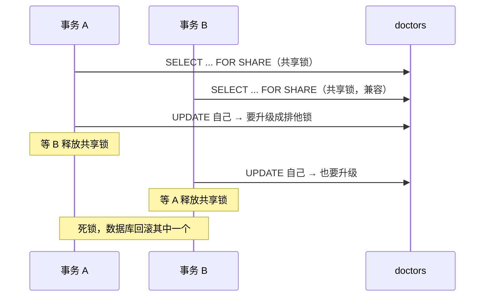
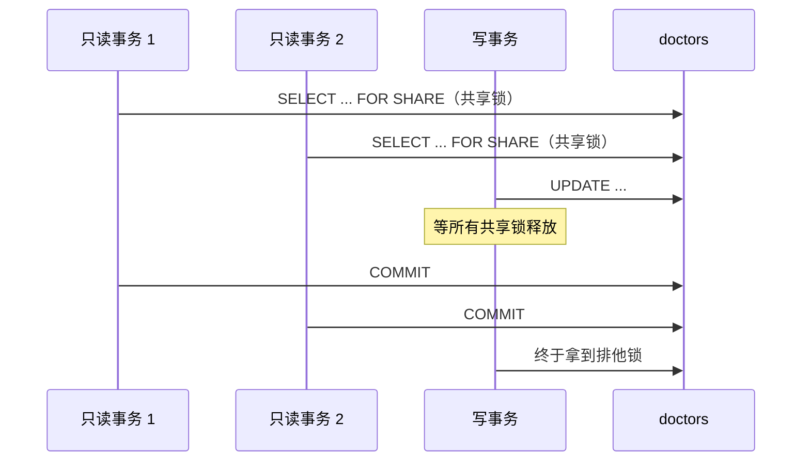
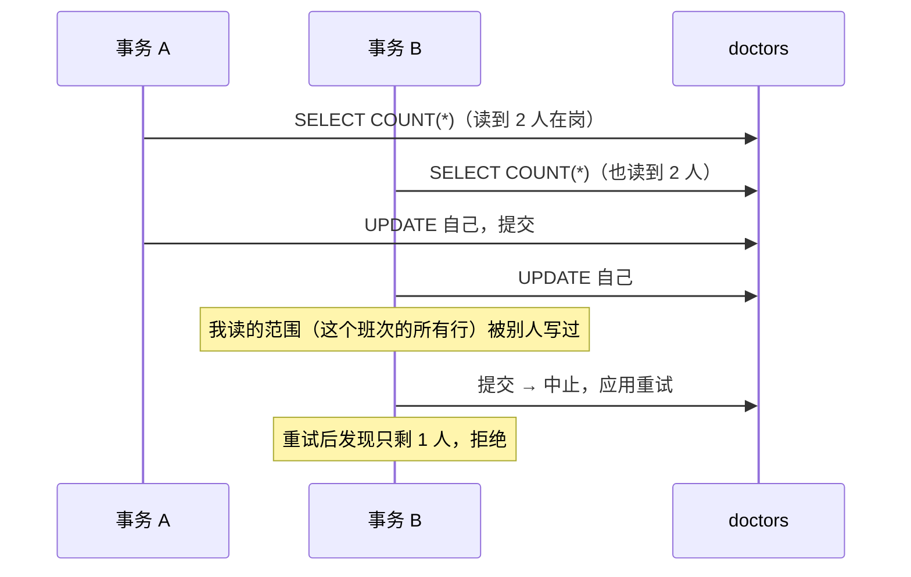
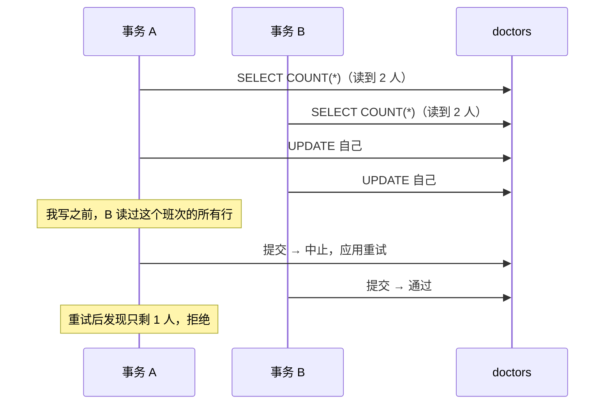

# 被误解的可串行化

在快照隔离级别中，可串行化似乎是不怎么受人待见的……至少在大学里面确实如此。

先把几个误解拆掉。

**它不是“所有语句都串行执行”。** 串行只针对可能有并发冲突的语句，互不相关的照样并发。

**它不保证事务之间不交叉。** 它只保证最终结果等价于某个“先 A 后 B”或者“先 B 后 A”的串行顺序。SSI 就是典型：事务 A 和 B 的操作可以互相穿插，只要结果对得上。

**实现方式有两种。** 2PL（两阶段锁定）和 SSI（可串行化快照隔离）。

## 2PL：两阶段锁定

> 可以理解成：给读语句自动加 `FOR SHARE`，给写语句自动加 `FOR UPDATE`。

所以上一篇 [数据库中的事务](./01-transactions_in_databases.md) 里提到的锁升级，在这里会出现。

### 锁升级导致的死锁



2PL 遇到这种情况会终止一个事务，由应用层重试。重试的时候重新读，如果发现前提已经不成立（比如只剩一个人在岗），就拒绝这次请求。

### 读多写少时的浪费



问题在于：这些读如果都是只读事务，根本不需要挡住写。

只读事务不会造成写偏斜，2PL 却照样锁住，纯粹是性能浪费。

> 不过实际上 MySQL 的可串行化只有 2PL，当我没说。

## SSI：可串行化快照隔离

每个事务记录自己读了什么范围、写了什么范围。

提交之前检查两条：

- 自己读之后，有没有被别人写过
- 自己写之前，有没有被别人读过

满足至少一条，提交失败，应用层重试。

### 第一种冲突：读之后被人改



B 判断“还有 2 人”时，A 还没提交。等 B 要提交，A 已经提交了，B 读到的前提失效。

### 第二种冲突：写之前被人读过



这次是 A 倒霉。它要写的数据，B 在它写之前读过，所以 A 的写影响了 B 的判断。

### 为什么建议晚点重试

如果立刻重试，可能又和上一次还没结束的事务撞上，再次失败。

2PL 没有这个问题，因为它加了锁，冲突的那个已经卡住了，重试的人会排在后面。

SSI 不锁，重试是“大家各跑各的”，立刻重试容易反复撞。

### 和 2PL 的取舍

```
读多写少    SSI 更好，读不被写阻塞
高并发      SSI 可能一直重试，反而不如 2PL
```

SSI 的代价是把“执行时加锁”换成了“提交时检查 + 重试”。冲突率一高，重试的成本就压过来了。

## 存储过程

存储过程通常和可串行化配套用。

交互式事务里，每一次网络往返都是几毫秒。如果事务一条一条发 SQL，串行执行的时候 CPU 就在这几毫秒里干等。

所以要把整个事务一次性交给数据库，让它在内部跑完。本质上是在降低单个 CPU 的空转，把网络往返的延迟省掉。

代价是版本管理难、调试难，现在用的人比较少了。
