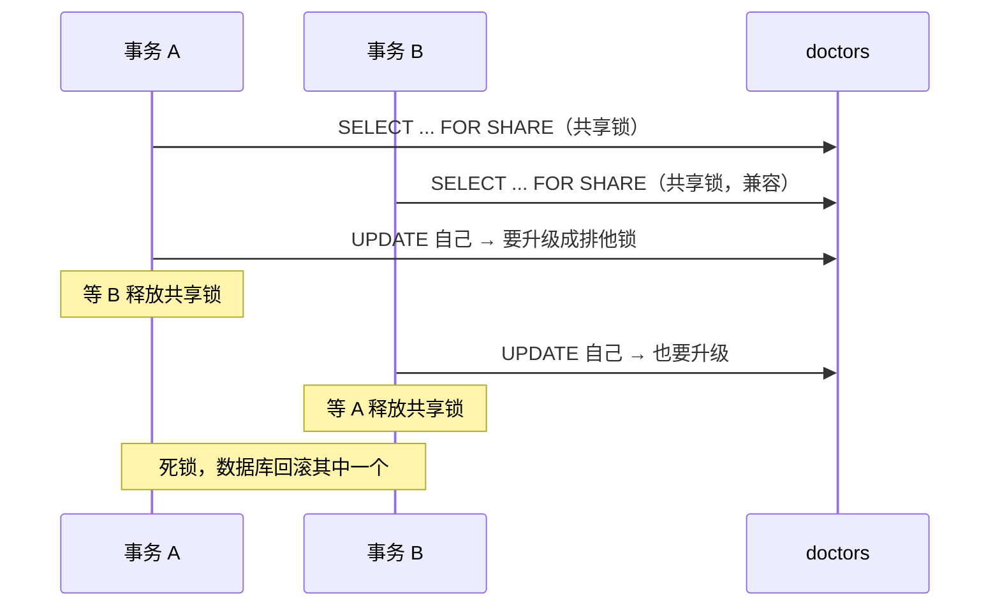
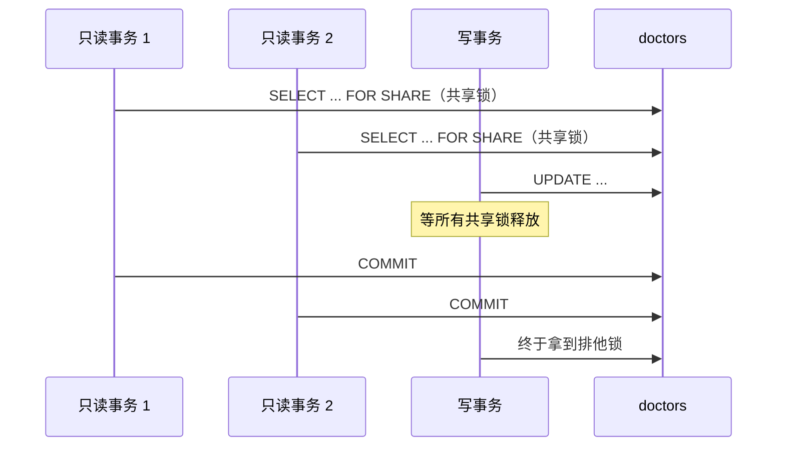
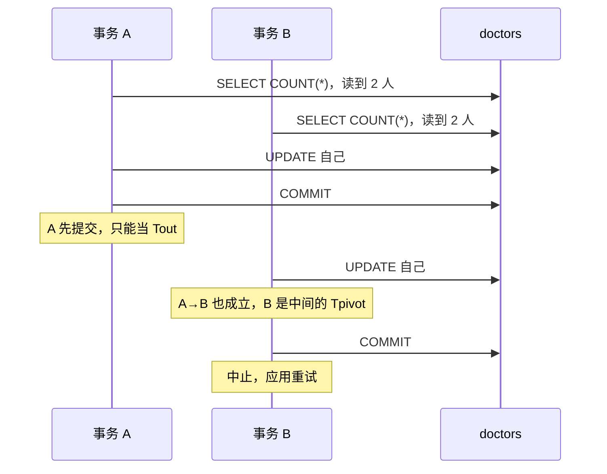
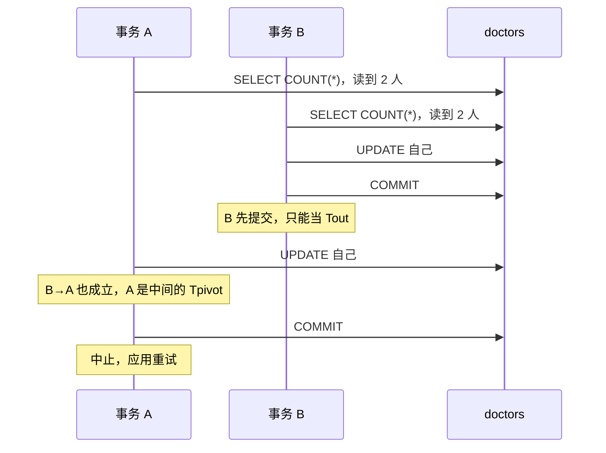

# 被误解的可串行化

可串行化在实际项目中并不常用，大学课程里也很少展开。

先从几个常见的误解开始。

**它不是“所有语句都串行执行”。** 串行只针对可能产生并发冲突的语句，互不相关的操作照常并发。

**它不保证事务之间不交叉。** 它只保证最终结果等价于某个“先 A 后 B”或“先 B 后 A”的串行顺序。SSI 就是典型：事务 A 和 B 的操作可以互相穿插，只要结果对得上。

**实现方式有两种。** 2PL（两阶段锁定）和 SSI（可串行化快照隔离）。

## 2PL：两阶段锁定

> 可以理解成：给读语句自动加 `FOR SHARE`，给写语句自动加 `FOR UPDATE`。

因此上一篇 [数据库中的事务](./01-transactions_in_databases.md) 里提到的锁升级，在这里会出现。

### 锁升级导致的死锁



2PL 遇到这种情况会终止其中一个事务，由应用层重试。重试时重新读取，如果发现前提已经不再成立（例如只剩一个人在岗），就拒绝这次请求。

### 读多写少时的浪费



这些读如果都来自只读事务，并不需要阻塞写操作。

只读事务不会造成写偏斜，2PL 却照样加锁，属于不必要的性能开销。

> 实际上 MySQL 的可串行化只实现了 2PL。

## SSI：可串行化快照隔离

快照隔离能避免大多数并发异常，但无法处理写偏斜：两个事务读取同一批数据，各自写入不同的行，互相看不到对方的写。

SSI 不阻塞读写，只在事务依赖图里检测一种特定结构。

### rw 依赖的两个方向

rw 依赖表示一个事务读过的数据，被另一个事务写了。

```
T1 读过的行 → T2 后来写了它      T1 --rw--> T2
```

从两个事务各自的视角看，有两种说法。

```
读之后被人改      T1 读，T2 写      T1 --rw--> T2
写之前被人读过    T1 写，T2 读      T2 --rw--> T1
```

两种说法指向同一条边，只是立足的事务不同。

### 危险结构

单独一条 rw 边不会导致异常，必须两条边相邻，共用一个中间事务。整条链不需要闭环，两端之间可以没有直接依赖。

```
Tin --rw--> Tpivot --rw--> Tout
```

中止的是中间的 Tpivot，前提是 Tout 先于 Tpivot 和 Tin 提交。

要求 Tout 先提交，是为了减少不必要的回滚。Tout 如果不是环里最先提交的事务，那么环里已经有别的事务先提交了，那个事务才是真正的 Tout。

### 医生值班：两条边闭环

两个事务都读取整个班次，然后各自写入自己那一行。

```
B 读 ──rw──> A 写
A 读 ──rw──> B 写
```

两条边相邻，共用中间的事务。先提交的事务作为 Tout，后提交的事务作为 pivot。

### 时序一：A 先提交



A 先提交，因此只能作为 Tout。B 完成写操作后环闭合，B 成为中间的 Tpivot。

B 判断“还有 2 人”时，A 还没有提交。等到 B 提交，A 已经提交，B 读到的前提失效。

### 时序二：B 先提交



两种时序对称。B 先提交，作为 Tout；A 完成写操作后环闭合，A 成为中间的 Tpivot。

### 写操作与提交的时机

rw 依赖在写操作执行时建立，不需要等待事务提交。

两个事务都完成写操作后，环已经闭合。此时先提交的事务成为 Tout。

```
A UPDATE
B UPDATE
A COMMIT     ← A 先提交，成为 Tout，通过
B COMMIT     ← B 是 pivot，中止
```

若改为 B 先提交，则 B 通过、A 中止。

Tout 由提交顺序决定，最先提交的事务成为 Tout。写操作的先后只决定依赖边建立的时点，不影响 Tout 的归属。因此决定回滚结果的是提交顺序。

### 结论

在两事务的环中，先提交的事务作为 Tout，后提交的事务作为 pivot 被中止。

“读之后被人改”和“写之前被人读过”并非两种不同的失败，而是同一条边的两个视角。判定依据只有危险结构和 pivot，与观察者所处的事务无关。

### 只读事务的角色

只读事务只读不写，不会成为 pivot。pivot 必须既写过别人读过的数据，又读过别人写的数据。

它只能出现在 Tin 的位置：它读了某一行，pivot 随后写了该行。

被中止的是中间的写事务，只读事务本身不受影响。它的代价在于自身的读参与构成了危险结构。

在 PostgreSQL 中显式声明 `READ ONLY` 后，数据库可以确定它不会写，直接将其从候选 pivot 中排除，判定也能提前结束。未声明时，数据库只能按“可能写”处理，需要保留读锁和冲突记录更久，带来额外的内存与检测开销。

这种保守处理不影响正确性，只影响性能。

### 为什么建议晚点重试

立即重试可能与上一次尚未结束的事务再次冲突，导致连续失败。

2PL 不存在这个问题，因为锁已经阻塞了冲突事务，重试会排在后面。

SSI 不加锁，重试的事务与冲突事务并行执行，立即重试容易反复碰撞。

### 和 2PL 的取舍

```
读多写少    SSI 更好，读不被写阻塞
高并发      SSI 可能一直重试，反而不如 2PL
```

SSI 的代价是把“执行时加锁”换成了“提交时检查加重试”。冲突率升高后，重试成本会迅速上升。

## 存储过程

存储过程通常和可串行化配套使用。

交互式事务里，每一次网络往返都是几毫秒。如果事务一条一条发 SQL，串行执行时 CPU 就在这几毫秒里空等。

所以要把整个事务一次性交给数据库，让它在内部执行完。本质上是在降低单个 CPU 的空转，把网络往返的延迟省掉。

代价是版本管理困难、调试困难，目前在生产环境中使用较少。
