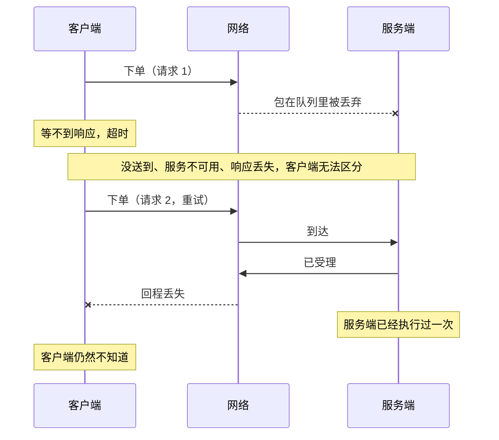
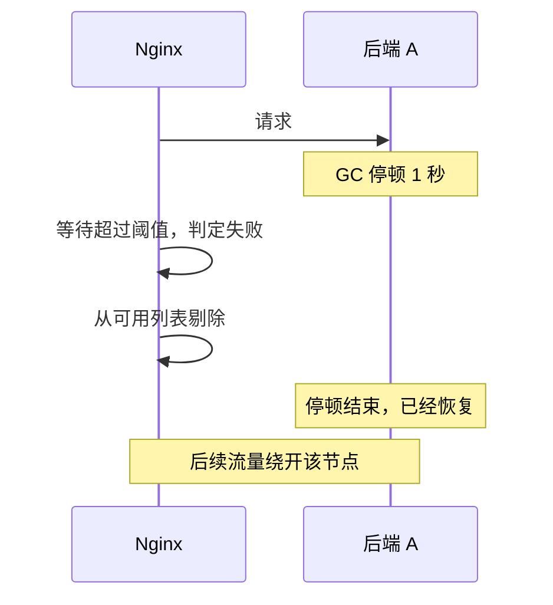
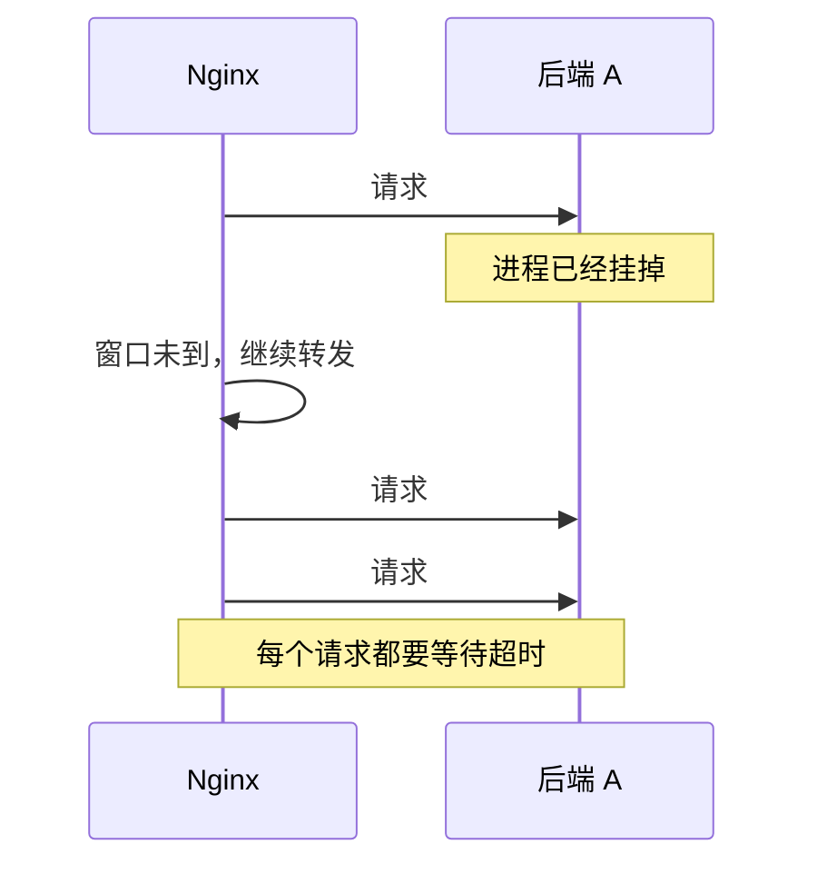
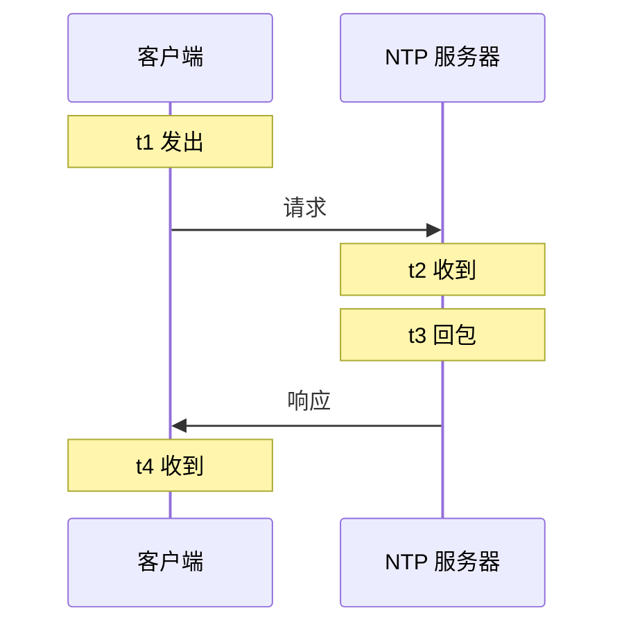
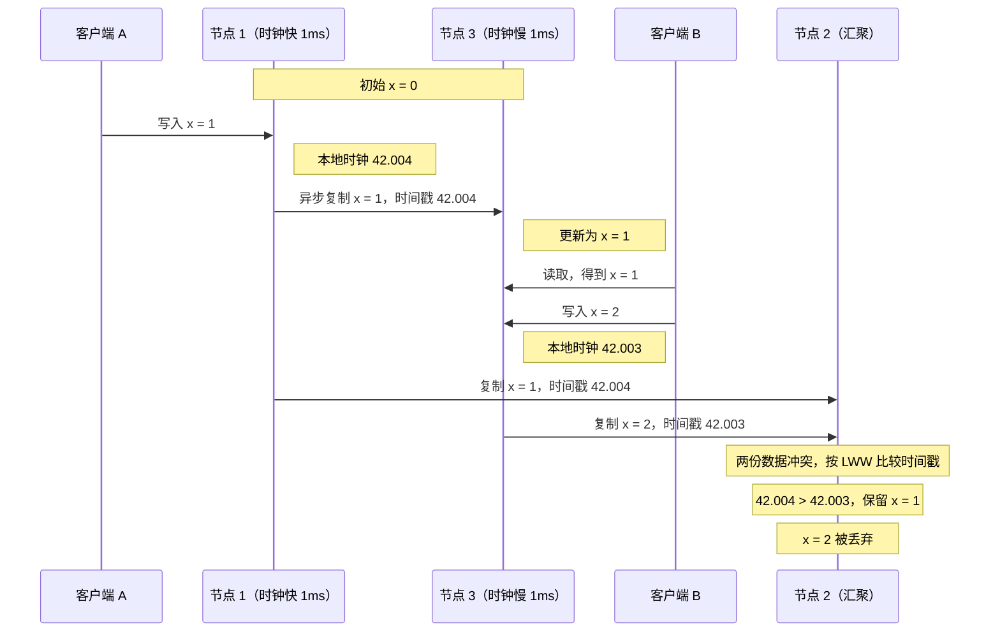
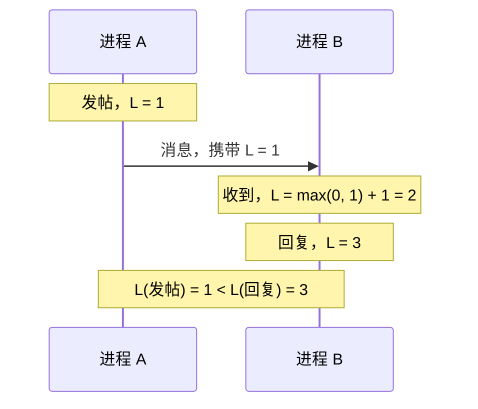
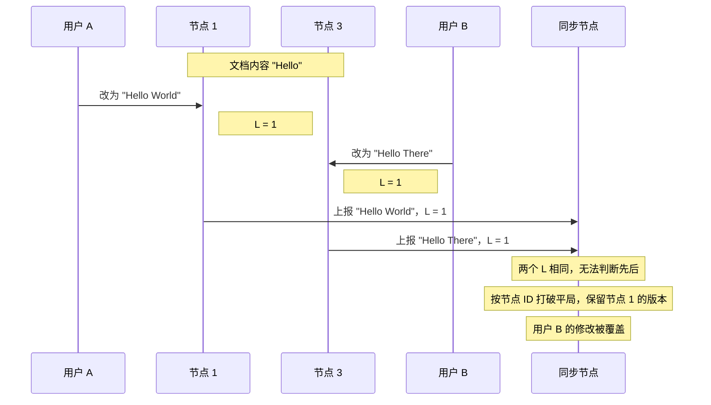

# 破碎的现实：直面现实的不确定性

> 毫无疑问，这就是后端要解决的核心问题，没有之一

即使一个系统在逻辑上完美无缺，面对机房断电、光缆被挖断、程序 GC 阻塞、网络拓扑调整，甚至地区的政策变化，它还能保持可用性与正确性吗？

现实中有各种各样的突发情况，但这并不意味着程序要面面俱到地自动解决（边际收益降低），提前考虑这些问题有助于提高程序的抗风险能力。

不同可用性目标对应的不可用时间如下：

| 评估维度           | 99.9%                                  | 99.99%                                 |
| ------------------ | -------------------------------------- | -------------------------------------- |
| **年度不可用时间** | 8.76 小时                              | 52.56 分钟                             |
| **月度不可用时间** | 43.2 分钟                              | 4.32 分钟                              |
| **每周不可用时间** | 10.08 分钟                             | 1.01 分钟                              |
| **每日不可用时间** | 1.44 分钟（86.4 秒）                   | 8.64 秒                                |
| **适用业务场景**   | 内部系统、常规企业应用、一般 SaaS 服务 | 电商核心交易、金融支付、高并发在线服务 |

> 系统的整体可用性受限于所有强依赖组件可用性的乘积。例如，如果应用程序调用了数据库、缓存和第三方网关，且三者各自的可用性都是 99.9%，那么整个链路的理论可用性就会下降到 $0.999^3 \approx 99.7\%$。因此，要让对外服务达到 99.99%，底层基础设施（如云厂商的 ECS、RDS）往往需要达到 99.995% 甚至更高。

本篇从网络的不确定性与时间的不确定性两个方向，探讨人们为了对抗破碎的现实所做的妥协。

## 网络的不确定性

当向某个服务发起请求并期待响应时，响应迟迟未到，最终被判定为超时。

那么是请求根本没有送到，还是服务已经不可用，还是响应在半路上丢失？又或者只是某一跳超时，但流程仍在尝试推进？



幂等键无法完全解决这个问题。它能挡住重复执行，但客户端仍然不知道上一次是否已经成功。超时之后只有两个选择：重试可能重复，放弃可能失败。

只有服务提供方自己支持幂等键参数时，才能由对方完成去重。

对于自己的服务，性价比最高的兜底手段通常是对账。

这类问题不只出现在自己的服务里。Nginx 会把没有响应或连接超时的后端节点暂时剔除，剔除窗口设成多少是一个需要权衡的参数。

窗口过短时，一次偶发延迟就会被判定为超时，节点在很短时间后自动恢复，流量反复切换，引起振荡。



窗口过长时，故障节点在窗口结束前仍会持续收到请求，每个请求都要等待一次超时。



Raft 的选主面临同样的问题。如果判定旧主下线的窗口过短，而主节点心跳因为网络延时晚到，就有可能出现双主，因此心跳周期必须远小于下线判定窗口。

理想的做法是根据历史成功率和延迟动态调整超时时间，代价是引入额外的复杂度，例如熔断器的半开状态：先放少量请求试探，确认恢复后再放开全量。

### 为什么网络延时难以预测

需要先区分同步网络和异步网络。

同步网络的延迟有固定上界，发出请求后没有回应，可以确定它已经丢失。

异步网络的延迟没有上界，可能任意长。发出请求后没有回应，无法判断是丢了、还没到，还是回包丢了。

一次请求的延迟可以拆成四段：

$$
T = T_{\text{tx}} + T_{\text{prop}} + T_{\text{proc}} + T_{\text{queue}}
$$

$T_{\text{tx}}$ 是传输时延，数据推上链路，取决于包长与带宽；$T_{\text{prop}}$ 是传播时延，电信号跑光纤，取决于距离；$T_{\text{proc}}$ 是处理时延，交换机查表转发，基本固定；$T_{\text{queue}}$ 是排队时延，等待前面的流量先通过。

前三项可以计算，但第四项不能。排队时长取决于同一时刻有多少流量竞争同一条链路，无法提前得知。

同步网络要求独占线路，容量预先留给单一使用者，这段时间内其他流量无法占用。请求不与其他流量排队，也就不会因此丢包，延迟才存在可预测的上界。

异步网络依靠统计复用提高利用率，链路并不独占。其他流量会影响本请求的排队时长，因此无法给出延迟上界，也无法确定需要重试多少次。

## 时间的不确定性

后面讨论的时间问题都出现在多主复制或无主复制（Leaderless）中。单主复制或按 Key 分片的系统里，每个 Key 只有一个节点负责写入，写入天然串行，不需要用时间戳判断先后。

| 维度     | 一致性哈希 / 单主分片     | 多主复制 / Leaderless               |
| -------- | ------------------------- | ----------------------------------- |
| 数据分布 | 每个 Key 只有一个权威节点 | 每个 Key 有多个平等副本             |
| 写入方式 | 必须找到唯一节点才能写入  | 可以在任意副本上直接写入            |
| 冲突来源 | 几乎无冲突，写入串行      | 高频并发冲突，需要 LWW 或 CRDT 解决 |
| 核心优势 | 数据不重复，存储效率高    | 低延迟、高可用，支持离线写入        |

多个副本都能写入，就必然出现两个副本对同一份数据给出不同结果的情况，需要一套规则决定谁赢。最直接的想法是比较写入时间，用墙上时钟。下面说明为什么这条路走不通。

时间分为墙上时间与单调时间两种。

| 维度                  | 墙上时间                                                    | 单调时间                                              |
| --------------------- | ----------------------------------------------------------- | ----------------------------------------------------- |
| **时间基准**          | 现实历法与时区（如 UTC / 本地时间，通常从 1970-01-01 起算） | 某个固定起点（通常为系统启动时刻）起流逝的时间        |
| **单调性**            | **不保证单调**（可能向前跳或向后回拨）                      | **严格单调递增**（不会回拨）                          |
| **受校时/夏令时影响** | **会受影响**（NTP 同步、手动改时间、夏令时切换都会改变它）  | **不受影响**（系统校时不会直接回拨单调时钟）          |
| **跨重启一致性**      | 跨机器、跨重启仍有统一日历语义                              | 仅在当前系统生命周期内有意义，重启后重新计数          |
| **典型用途**          | 日志时间戳、定时任务调度、展示给用户的时间、过期时间点      | 测算代码耗时、超时控制、性能统计、间隔计时            |
| **常见风险**          | 时间回拨可能导致耗时算成负数、锁提前过期或事件乱序          | 不能直接对应现实中的“几点几分”或跨进程/跨机器绝对时间 |

NTP 同步可以修正时钟漂移，但校时依赖网络传输，本身也带有延迟。



设服务器时钟比客户端快 $\theta$，去程延迟为 $d_1$，回程延迟为 $d_2$，四个时间戳满足：

$$
\begin{aligned}
t_2 &= t_1 + \theta + d_1 \\
t_4 &= t_3 - \theta + d_2
\end{aligned}
$$

两式联立：

$$
\theta = \frac{(t_2 - t_1) + (t_3 - t_4)}{2} - \frac{d_1 - d_2}{2}
$$

后一项无法计算。NTP 假设往返对称，即 $d_1 \approx d_2$，于是取：

$$
\hat{\theta} = \frac{(t_2 - t_1) + (t_3 - t_4)}{2}
$$

误差上界为：

$$
\left| \theta - \hat{\theta} \right| = \frac{|d_1 - d_2|}{2} \le \frac{\mathrm{RTT}}{2}, \qquad \mathrm{RTT} = d_1 + d_2
$$

因此同机房可以做到亚毫秒，跨洲通常在几十毫秒。链路越长、网络越不稳定，需要的校准越频繁，误差也越大。

墙上时间与 NTP 校准结果不一致时，需要调整系统时钟，方式有两种：

1. 跳变：直接把时钟设为正确值，读数在瞬间变化，程序可能观察到时间倒退。
2. 改速率：保持当前读数不变，只调整走时速率。时钟变快时调慢，变慢时调快。时间保持连续，仅速率发生变化。

常见实现以改速率为主，偏差超过阈值时才跳变一次。

因此一台机器的墙上时间可能从 10:00 直接变成 09:58。计算时间间隔时不能依赖墙上时间。

单调时间从开机起算，严格单调递增，适合用于计算间隔。

### 各语言的处理方法

Go 把两份读数放进同一个结构体：

```go
type Time struct {
    wall uint64     // 最高位标记是否带单调读数，其余分给秒和纳秒
    ext  int64      // 带单调时存单调读数，不带时存秒
    loc  *Location  // 时区
}
```

```go
time.Now()             同时拿到墙上和单调两份读数
Sub / Since            两个都带单调才用单调相减
t.UTC() / t.In(loc)    重新计算墙钟，单调读数被丢弃
json.Marshal(t)        只写墙钟
```

`t.UTC()` 和 `t.In(loc)` 会重新计算墙钟，单调读数随之丢弃，此后 `time.Since(t)` 退化为墙上时钟相减。

Python 把两者分开：

```python
time.time()        # 墙上时间，float
time.monotonic()   # 单调时间，float
time.time_ns()     # 墙上时间，int 纳秒，精度高于 float
datetime.now()     # 墙上时间，没有单调概念
```

`datetime` 相减全部基于墙钟。`time.monotonic()` 只适合计算间隔，不能作为时间戳存储。

无论哪种语言，序列化和反序列化都会丢弃单调时间。序列化的目的是传输与存储，而单调时间的起点是本机的开机时刻，不同机器的起点互不相同，保留下来也无法在另一台机器上使用（因为开机时间也是墙上时间），因此反序列化得到的时间不能用于计算间隔。

### 用墙上时钟排序的失败案例

多主复制里常见的冲突解决方案是 LWW（Last Write Wins），比较每次写入携带的时间戳，保留最大的那个。

节点 1 的时钟比真实时间快 1 毫秒，节点 3 慢 1 毫秒。客户端 B 在节点 3 上读到 $x = 1$，随后写入 $x = 2$。这次写入在物理上晚于 $x = 1$，但时间戳更小。



节点 2 收到两份数据，按 LWW 比较时间戳，保留 $x = 1$，丢弃 $x = 2$。

$x = 2$ 是在读到 $x = 1$ 之后写入的，因果上更晚。但 LWW 只看时间戳，看不到这层关系。时间戳的大小由时钟决定，时钟有误差，误差方向不对时，后发生的事件会被判定为更早。

问题不止出在精度。即使两个时钟完全同步，同一毫秒内的两次写入仍然需要打破平局，而打破平局的方式（比如比较节点 ID）与业务语义无关。

要判断事件的先后，不能问“几点了”，只能问“谁见过谁”。这是逻辑时钟的出发点。

## 用逻辑时钟排序

Lamport 时钟的做法是：A 向 B 发送消息意味着 A 的事件先发生，借此为事件排序。

```
每个进程维护一个计数器 L

本地事件          L = L + 1
发送消息          消息携带当前的 L
接收消息          L = max(L, 收到的 L) + 1
```

接收时的 $\max$ 保证收到消息后的时间戳一定大于发送方。



Lamport 时钟只保证因果顺序，不保证真实先后。物理上的先后在分布式系统中无法获知。

因果链为 发帖 → 回复，$L(e_{\text{post}}) = 1 < L(e_{\text{reply}}) = 3$，因此排序后回复一定位于发帖之后，不会出现违背因果的排列。

所有节点按同一规则计算，得到相同的顺序即可。并发事件本身没有真实先后，只需要保证各节点选择同一个顺序。

Lamport 时钟有两个限制。

第一，单向性。$a \to b$ 可以推出 $L(a) < L(b)$，反之不成立。并发事件的时间戳也可能一大一小，因此它只能用于定序，无法检测并发。

第二，不保证最后写入胜出。两个并发的写按 $L$ 排序后，后一个会覆盖前一个，可能丢失需要保留的数据，因此还需要向量时钟或 CRDT。

### 两个人同时编辑

两个用户在不同节点上编辑同一份文档，彼此没有看到对方的修改。



两次编辑都基于同一份 "Hello"，彼此没有消息往来，属于并发事件。Lamport 给它们的序号都是 1，既分不出先后，也判断不了它们是并发。

同步节点只能按某个规则选一个，比如比较节点 ID。选节点 1，B 的修改没了；选节点 3，A 的修改没了。两种结果都丢掉一个人的工作。

问题出在合并方式。编辑不能像计数器那样相加，必须逐段合并。但在合并之前，系统得先知道这两次编辑是并发，而不是先后关系。如果 B 是在收到 A 的同步之后才改的，那么 B 的版本已经包含 A 的修改，直接采信 B 即可；如果没收到，就必须合并。

Lamport 时钟分不清这两种情况，因为它的序号是单向的：$L(a) < L(b)$ 推不出 $a \to b$。

向量时钟能补上检测这一环。每个节点记录自己知道的其他节点进度，两个向量互不支配时即为并发。检测出并发之后，还需要一套确定的合并规则，把两侧的修改都保留下来，这由 OT 或 CRDT 提供。

### 向量时钟

> 本节内容未在项目中实践，我本人也无法复述，仅作了解。

向量时钟用于弥补 Lamport 时钟无法检测并发的缺陷。

每个进程维护一个长度为 $N$ 的向量，$N$ 为节点数：

```
本地事件      自己的分量 +1
发送消息      携带整个向量
接收消息      逐分量取 max，然后自己的分量 +1
```

比较规则：

$$
V_1 < V_2 \iff \forall i,\ V_1[i] \le V_2[i] \ \land\ V_1 \ne V_2
$$

若两个向量互不支配，即既存在 $V_1[i] > V_2[i]$，又存在 $V_1[j] < V_2[j]$，则对应事件并发。

由此可以双向判断：$a \to b$ 当且仅当 $V(a) < V(b)$。代价是每条消息携带 $N$ 个整数，节点数量增加后开销随之上升。

|              | Lamport 时钟    | 向量时钟       |
| ------------ | --------------- | -------------- |
| 空间开销     | O(1)            | O(N)           |
| 因果顺序     | 单向            | 双向           |
| 能否检测并发 | 不能            | 能             |
| 典型用途     | 定序、tie-break | 冲突检测、合并 |

向量时钟的逐分量取 $\max$ 满足交换律、结合律和幂等律，但这只说明“合并两个已知向量”的结果稳定，不代表向量时钟本身是 CRDT。

向量时钟只用于检测并发，不承载业务数据。它接收消息时要把本地分量加一，这个操作不幂等：同一条消息重复投递，本地分量会多加一次，实际使用需要对消息去重。

CRDT 是另一类东西，定义的是业务数据在并发写入下如何合并。计数器是典型例子：每个节点只记录自己的增量，合并时逐节点取 $\max$，最终值为各分量之和。A 记 600，B 记 300，合并得到 900，两笔收入都不会丢。

CRDT 的合并同样要求交换律、结合律和幂等律，但作用对象是业务状态，不是因果向量。

常见的 CRDT 有三种。

**G-Counter（只增计数器）**：每个节点只维护自己的分量，本地加一只加自己那一项。合并时逐分量取 $\max$，总值是所有分量之和。两家分店各自记账，A 记 600，B 记 300，合并后是 900。

**PN-Counter（增减计数器）**：内部是两个 G-Counter，一个记增加，一个记减少。本地加一就往 P 里加，减一就往 N 里加。合并时两个分别合并，总值是 $\mathrm{sum}(P) - \mathrm{sum}(N)$。

**OR-Set（可增删集合）**：每次 add 生成一个唯一标签，元素对应一组标签。remove 只删除当前能看到的那些标签。合并时对每个元素的标签集合取并集，集合非空则元素存在。并发 add 和 remove 时 add 胜出，因为 remove 删不到它没见过的标签。

三者的共同点是合并结果与操作顺序无关，所以副本可以各自推进、最后收敛到同一状态。代价是状态会随节点数和操作次数增长，实际实现通常用版本向量之类的结构压缩已删除的标签。
